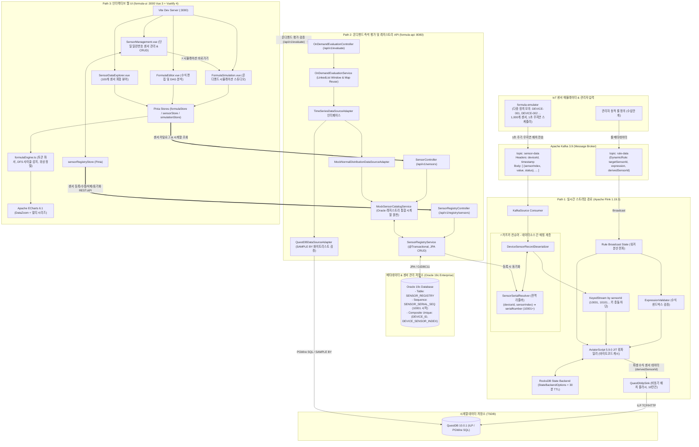
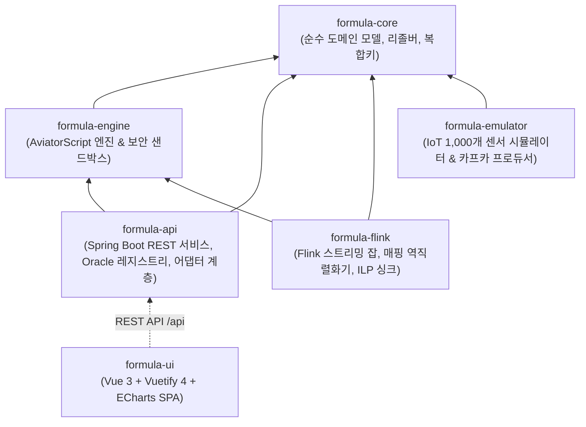
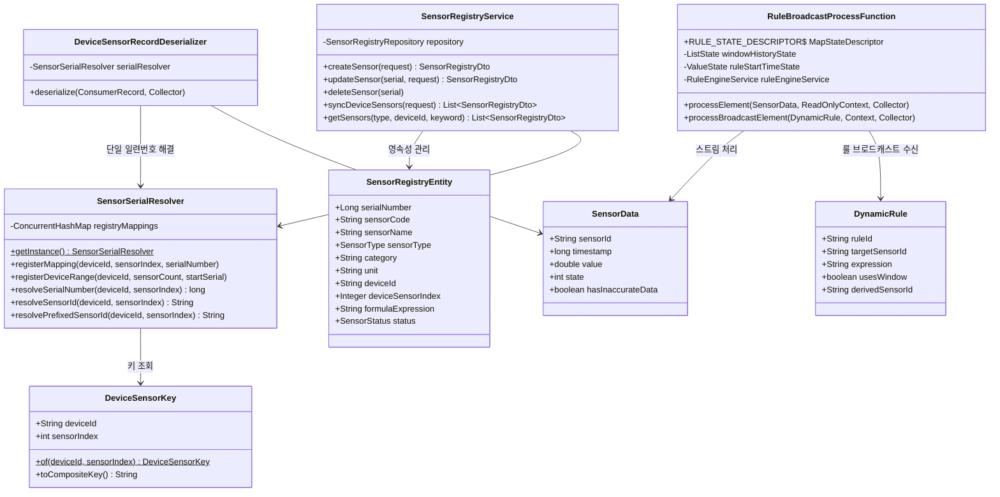
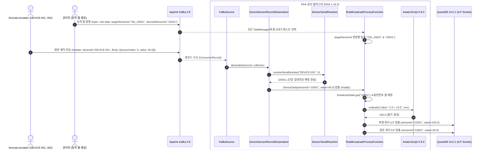

# 🚀 Formula Evaluator Service: 대규모 시스템 아키텍처 및 상세 가이드

본 문서는 대규모 IoT 시계열 데이터 평가 시스템(**Formula Evaluator Service**)의 아키텍처, Gradle 멀티 모듈 및 프론트엔드 모노레포 구조, 고성능 분산 처리 원리, 단일 센서 일련번호 체계 및 오라클 19c 영속화, 런타임 보안 샌드박스 및 운영 가이드를 총망라한 엔지니어링 기술 문서입니다.

---

## 1. 시스템 탄생 배경 및 설계 원칙

### 1.1 해결 과제 (High Cardinality & High Throughput)
* **초고속 유입량**: 산업 현장의 수백만 대 설비(Sensor)로부터 1초 이하 간격으로 대규모 원본 시계열 데이터가 쏟아져 들어옵니다.
* **장치별 센서 인덱스 충돌**: 각 IoT 장치(`DEVICE-001`, `DEVICE-002` 등)가 독립적으로 `sensorIndex: 0..N`을 발급할 경우, 중앙 스트리밍 엔진과 평가 시스템에서 센서 식별자 충돌(Key Collision)이 발생합니다.
* **동적 수식 평가**: 수십만 개의 사용자 정의 룰(Rule, 예: `value > 50 && window_avg(10) > 15`)을 시스템 중단 없이 런타임에 즉각 컴파일하여 파생 데이터를 계산해야 합니다.
* **보안 및 DoS 방어**: 런타임에 유입되는 사용자 정의 수식이 임의 코드 실행(Remote Code Execution), 시스템 클래스 로딩, 무한 루프, DoS 공격을 유발하지 않도록 철저한 샌드박스와 유효성 검증이 요구됩니다.
* **단일 RDBMS의 한계**: 건별 INSERT/SELECT에 의존하는 구조는 커넥션 고갈, 잠금(Lock) 경합, GC 오버헤드로 인해 초고속 스트리밍 환경에서 병목을 일으킵니다.

### 1.2 듀얼 패스(Dual-Path) 아키텍처 원칙
이러한 요구사항을 해결하기 위해 시스템의 처리 경로를 **실시간 스트리밍 경로(Streaming Path)**와 **온디멘드 즉석 평가 경로(On-Demand Path)**로 명확히 분리하고, 이를 시각화 및 통합 관리할 수 있는 **인터랙티브 프론트엔드 UI(Formula UI)**와 **Oracle 19c 기반 단일 센서 일련번호 관리 체계**를 결합하였습니다.

| 비교 항목 | 1. 실시간 스트리밍 경로 (Streaming Path) | 2. 온디멘드 즉석 평가 경로 (On-Demand Path) | 3. 인터랙티브 관리/시뮬레이션 (Formula UI) |
| :--- | :--- | :--- | :--- |
| **핵심 엔진** | **Apache Flink 1.19.3** + RocksDB | **Spring Boot 3.5.16** + **QuestDB 10.0.1** | **Vue 3 + Vite 8** Client JIT Engine |
| **센서 식별 체계**| **단일 일련번호(`10001+`)** (리졸버 변환) | **단일 일련번호(`10001+`)** (Oracle SSOT) | **단일 일련번호 관리 UI** (`SensorManagement`) |
| **처리 대상** | 실시간 유입되는 무한 센서 스트림 | 과거 수억 건의 축적된 시계열 데이터 백테스팅 | 100개 가상 센서 + 등록 센서 수식 DAG 시뮬레이션 |
| **처리 지연시간** | Sub-second (밀리초 단위 스트리밍) | 대시보드 인터랙티브 조회 (수십~수백 밀리초) | 86,400초(1일) 데이터 연산 약 500ms |
| **룰 전파 방식** | Flink **Broadcast State** (워커 전원 로컬 복제) | Spring 빈 주입 기반 런타임 JIT 평가 | Pinia 스토어 + DAG 위상 정렬 (Topological Sort) |
| **상태/메타 저장소** | RocksDB StateBackend + 30분 State TTL | QuestDB 디스크 파티션 + LinkedList 윈도우 | **Oracle 19c** (`SENSOR_REGISTRY` & 시퀀스) |
| **데이터 소스** | Apache Kafka 3.9 (`sensor-data`, `rule-data`) | 플러그형 어댑터 (`MOCK`, `QUESTDB`, `RDBMS`) | 백엔드 `formula-api` REST API (오프라인 Fallback) |
| **주요 장점** | 무중단 룰 적용, 수평적 스케일아웃, OOM 방지 | DB 레벨 SIMD 벡터화 다운샘플링 (`SAMPLE BY`) | 통합 센서 관리(CRUD, 동기화), 파형 시각화 |



---

## 2. 프로젝트 멀티 모듈 및 프론트엔드 아키텍처

프로젝트는 관심사 분리(Separation of Concerns)와 컴포넌트 재사용성을 극대화하기 위해 **5개의 백엔드 모듈**과 **1개의 모던 웹 프론트엔드 모듈**로 구성되어 있습니다.



### 모듈별 패키지 및 주요 클래스 파일 트리

```
formula-evaluator-service/
├── formula-core/                                # 순수 Java 도메인 모델 라이브러리
│   └── src/main/java/com/imoil/formula/domain/
│       ├── SensorData.java                      # 표준 시계열 데이터 모델 (sensorId, timestamp, value, state, hasInaccurateData)
│       ├── DynamicRule.java                     # 동적 룰 정의 (ruleId, targetSensorId, expression, usesWindow, derivedSensorId)
│       ├── SensorItem.java                      # 에뮬레이터 센서 항목 (sensorIndex, value, status)
│       ├── DeviceMessageHeader.java             # 에뮬레이터 헤더 모델 (deviceId, timestamp)
│       ├── DeviceSensorMessage.java             # 에뮬레이터 Envelope 메시지 (header, body)
│       ├── DeviceSensorKey.java                 # [신규] 장치-센서 복합 키 모델 (deviceId, sensorIndex)
│       └── SensorSerialResolver.java            # [신규] 단일 일련번호 매핑 및 결정론적 격리 리졸버
├── formula-engine/                              # 수식 컴파일, 평가 및 보안 샌드박스
│   └── src/main/java/com/imoil/formula/engine/
│       ├── ExpressionValidator.java             # [보안] 수식 화이트리스트/블랙리스트 정규식 유효성 검증기
│       ├── RuleEngineConfig.java                # [보안] AviatorEvaluatorInstance 빈 설정 (클래스 차단, 기능 제한, 타임아웃)
│       ├── RuleEngineService.java               # 수식 JIT 컴파일 및 바이트코드 캐시 실행 서비스
│       └── functions/
│           ├── AbstractWindowFunction.java      # 윈도우 집계 함수 공통 방어 추상 클래스
│           ├── WindowAvgFunction.java           # window_avg(N) 이동 평균 커스텀 함수
│           └── WindowMaxFunction.java           # window_max(N) 이동 최댓값 커스텀 함수
├── formula-api/                                 # Spring Boot REST 애플리케이션, Oracle 레지스트리 & 데이터소스 어댑터
│   ├── src/main/resources/
│   │   ├── application.yml                      # Oracle 19c, QuestDB, H2 멀티 프로파일 설정
│   │   └── schema-oracle.sql                    # [신규] SENSOR_REGISTRY 테이블 및 SENSOR_SERIAL_SEQ DDL
│   └── src/main/java/com/imoil/formula/
│       ├── FormulaEvaluatorApplication.java     # Spring Boot 메인 엔트리포인트 (@EnableScheduling)
│       ├── api/
│       │   ├── OnDemandEvaluationController.java # GET /api/v1/evaluate
│       │   └── SensorController.java            # GET /api/v1/sensors (100개 센서 카탈로그 & 시계열 조회)
│       ├── registry/                            # [신규] 단일 센서 일련번호 영속성 패키지
│       │   ├── controller/
│       │   │   ├── SensorRegistryController.java # 센서 CRUD, 일괄 동기화, 채번 프리뷰 REST API
│       │   │   └── SensorRegistryExceptionHandler.java # 400 Bad Request / 409 Conflict 예외 핸들러
│       │   ├── domain/
│       │   │   ├── SensorStatus.java            # ACTIVE, INACTIVE, MAINTENANCE
│       │   │   └── SensorType.java              # PHYSICAL, FORMULA
│       │   ├── dto/
│       │   │   ├── CreateSensorRequest.java     # 센서 등록 DTO
│       │   │   ├── UpdateSensorRequest.java     # 센서 수정 DTO
│       │   │   ├── DeviceSyncRequest.java       # IoT 장치 일괄 동기화 DTO
│       │   │   └── SensorRegistryDto.java       # 센서 정보 응답 DTO
│       │   ├── entity/
│       │   │   └── SensorRegistryEntity.java    # Oracle 19c SENSOR_REGISTRY JPA 엔티티
│       │   ├── repository/
│       │   │   └── SensorRegistryRepository.java # JPA 레포지토리 (복합 유니크 검증, 검색 쿼리)
│       │   └── service/
│       │       └── SensorRegistryService.java   # 일련번호 채번, 동기화, SensorSerialResolver 연동
│       ├── config/
│       │   ├── QuestDBConfig.java               # QuestDB Sender 클라이언트 & No-Op Fallback Dynamic Proxy
│       │   └── TimeSeriesDataSourceConfig.java  # DataSourceType 조건부 Bean 구성
│       ├── datasource/
│       │   ├── DataSourceType.java              # QUESTDB, RDBMS, STREAMING_BUFFER, MOCK
│       │   ├── TimeSeriesDataSourceAdapter.java # 플러그형 시계열 데이터소스 인터페이스
│       │   ├── TimeSeriesQueryCriteria.java     # 쿼리 파라미터 DTO (sensorId, range, sampleBy)
│       │   ├── MockNormalDistributionDataSourceAdapter.java # 정규분포 시계열 어댑터
│       │   ├── QuestDBDataSourceAdapter.java    # QuestDB PGWire SQL 연동 어댑터
│       │   ├── RdbmsDataSourceAdapter.java      # JDBC 기반 범용 RDBMS 어댑터
│       │   └── StreamingBufferDataSourceAdapter.java # 인메모리 링버퍼 어댑터
│       └── service/
│           ├── MockSensorCatalogService.java    # [SSOT] Oracle 레지스트리와 통합된 1시간 시계열 생성
│           ├── OnDemandEvaluationService.java   # LinkedList 윈도우 & Map 재사용 기반 온디멘드 평가기
│           ├── QuestDBIngestionService.java     # 스레드 안전 ILP 배치 인제스천 서비스
│           └── QuestDBRetentionService.java     # 파티션명 검증 기반 DROP PARTITION 일별 자동 정리
├── formula-flink/                               # Apache Flink 분산 스트리밍 처리 잡
│   └── src/main/java/com/imoil/formula/flink/
│       ├── AppConstants.java                    # Kafka 토픽, 파라미터 키 및 기본 설정값 상수
│       ├── StreamingEvaluatorJob.java           # Flink Job 메인 (StateBackendOptions 설정, Broadcast 파이프라인)
│       ├── DeviceSensorRecordDeserializer.java  # [신규] 카프카 컨슈머-데이터소스 간 단일 일련번호 변환 역직렬화기
│       ├── SensorSerialMappingFunction.java     # [신규] 스트림 상에서 센서 일련번호 보정 MapFunction
│       ├── RuleBroadcastProcessFunction.java    # [개선] 단일 일련번호/접두사 양방향 룰 매칭 및 파생 센서 방출
│       └── QuestDbIlpSink.java                  # 고속 QuestDB ILP 소켓 싱크 (배치/주기적 Flush)
├── formula-emulator/                            # Standalone IoT 센서 에뮬레이터 모듈
│   └── src/main/java/com/imoil/formula/emulator/
│       ├── SensorEmulatorApplication.java      # 에뮬레이터 독립 실행 애플리케이션
│       ├── config/EmulatorConfig.java           # 1,000개 센서, 1~10초 주기, 토픽 등 설정 빌더
│       ├── engine/
│       │   ├── EmulatedSensor.java              # 가우시안 랜덤 워크 및 장애 상태 전이 센서 모델
│       │   └── SensorDeviceEmulator.java        # 1초 주기 무지연 스케줄러(scheduleAtFixedRate)
│       └── kafka/SensorKafkaProducer.java       # 비동기 논블로킹 Kafka ProducerRecord 발송
└── formula-ui/                                  # Vue 3 + Vuetify 4 + TypeScript 웹 SPA
    └── src/
        ├── components/
        │   ├── SensorManagement.vue             # [신규] 통합 센서 일련번호 관리 (CRUD, IoT 장치 동기화, 시뮬레이션 연계)
        │   ├── FormulaList.vue                  # 수식 목록 조회, 검색, 필터링 및 관리
        │   ├── FormulaEditor.vue                # 수식 작성, 토큰 인서트, 실시간 DAG 사이클 분석
        │   ├── FormulaSimulation.vue            # 1시간 시계열 시뮬레이션 및 ECharts 차트 시각화
        │   └── SensorDataExplorer.vue           # 백엔드 연동 100개 센서 탐색기 및 파형 뷰어
        ├── services/
        │   ├── sensorRegistryApi.ts             # [신규] Oracle 센서 레지스트리 REST API 클라이언트
        │   ├── apiClient.ts                     # formula-api REST 연동 클라이언트 (온디멘드 평가)
        │   ├── circularBuffer.ts                # Float64Array 기반 O(1) 링 버퍼 구현체
        │   ├── formulaEngine.ts                 # 프리컴파일 정규식, 위상 정렬 시뮬레이터
        │   └── sensorDataGenerator.ts           # 오프라인 단독 구동용 Fallback 생성기
        ├── stores/
        │   ├── sensorRegistryStore.ts           # [신규] 센서 레지스트리 상태 관리 Pinia 스토어
        │   ├── sensorStore.ts                   # [개선] Oracle 등록 센서 동적 병합 카탈로그 스토어
        │   ├── formulaStore.ts                  # 수식 CRUD 및 localStorage 영속화 Pinia 스토어
        │   └── simulationStore.ts               # 시뮬레이션 실행 및 결과 제어 Pinia 스토어
        └── types/
            ├── sensorRegistry.ts                # [신규] 센서 레지스트리 및 DTO 인터페이스
            ├── formula.ts                       # 수식 및 시뮬레이션 결과 타입 정의
            └── sensor.ts                        # 센서 메타데이터 및 데이터포인트 타입 정의
```

### 모듈별 책임 및 주요 기술 스택

| 모듈명 | 기술 스택 | 핵심 역할 및 기능 |
| :--- | :--- | :--- |
| **`formula-core`** | Java 25, Lombok | 프레임워크 독립적인 순수 시계열 및 룰 도메인 모델, `DeviceSensorKey`, `SensorSerialResolver` 정의 |
| **`formula-engine`** | AviatorScript 5.9.0, Spring Context | 동적 수식 JIT 바이트코드 컴파일, 코드 인젝션 방어(`ExpressionValidator`), 보안 샌드박스, 윈도우 커스텀 함수(`window_avg`, `window_max`) |
| **`formula-api`** | Spring Boot 3.5.16, Spring Data JPA, Oracle OJDBC11, QuestDB Client | 온디멘드 수식 평가 REST API, **Oracle 19c SENSOR_REGISTRY 통합 일련번호 관리**, 플러그형 시계열 어댑터 계층, QuestDB 파티션 관리 |
| **`formula-flink`** | Apache Flink 1.19.3, RocksDB, Kafka Connector | 분산 스트리밍 파이프라인, **카프카 컨슈머-데이터소스 간 단일 일련번호 매핑 역직렬화기(`DeviceSensorRecordDeserializer`)**, Broadcast State 무중단 룰 전파, State TTL OOM 방지 |
| **`formula-emulator`** | Java 25, Kafka Clients 3.9, Jackson | 1,000개 센서 모의 생성, 1~10초 주기 독립 변동, 1초 무지연 스케줄러 기반 배치 카프카 비동기 발송 |
| **`formula-ui`** | Vite 8, Vue 3.5, Vuetify 4.2, ECharts 6.1, Pinia, TypeScript | **단일 센서 관리 UI(`SensorManagement.vue`)**, 온디멘드 수식 시뮬레이션, DAG 위상 정렬, `CircularBuffer` 기반 초고속 브라우저 시뮬레이션 |

---

## 3. 핵심 도메인 및 클래스 연관 구조



---

## 4. 고성능 비기능 요구사항(NFR) 및 보안 해결 메커니즘

### 🔒 4.1 엄격한 수식 보안 샌드박스 (Code Injection & DoS 방어)
사용자가 임의로 입력하는 동적 수식은 보안상 가장 취약한 지점입니다. 본 시스템은 3중 방어 메커니즘을 적용합니다.

1. **`ExpressionValidator` 사전 정적 분석**:
   - **문자열 길이 제한**: 500자 이하로 제한하여 비정상적으로 거대한 페이로드 사전 차단.
   - **허용 문자 정규식 화이트리스트**: 영문, 숫자, 밑줄, 공백, 사칙/논리/삼항 연산자(`+ - * / % ? : > < = ! & |`), 괄호, 쉼표, 마침표만 허용.
   - **단독 대입 연산자(`=`) 차단**: 상태 변경 공격 및 변수 덮어쓰기 방지 (`==`, `!=`, `>=`, `<=` 제외).
   - **위험 키워드 블랙리스트 차단**: `Class`, `System`, `Runtime`, `Process`, `ProcessBuilder`, `exec`, `eval`, `load`, `import`, `new`, `fn`, `let`, `def`, `while`, `for`, `try`, `catch`, `throw`, `java`, `org`, `com` 등을 완전 차단.
2. **Aviator 런타임 클래스 격리 (`RuleEngineConfig`)**:
   - `instance.setOption(Options.ALLOWED_CLASS_SET, Collections.emptySet())`: 모든 Java 리플렉션 및 클래스 접근을 원천 차단.
   - `Feature.NewInstance`, `Feature.StaticMethods`, `Feature.StaticFields`, `Feature.Module` 등 위험 기능 일체 비활성화.
3. **루프 및 타임아웃 제한**:
   - `MAX_LOOP_COUNT = 1000`, `EVAL_TIMEOUT_MS = 5000L` 설정을 통해 무한 루프 DoS 공격 방지.

### 🔒 4.2 SQL Injection 및 DDL Injection 방어
* **QuestDB SAMPLE BY 정규식 화이트리스트 검증**:
  - `SAMPLE BY` 구문은 SQL Prepared Statement로 파라미터 바인딩이 지원되지 않는 TSDB 전용 절입니다.
  - `QuestDBQueryRepository`는 정규식 `^[1-9][0-9]*(?:s|m|h|d|w|ms|M|y)$` 패턴에 매칭되는 유효한 시간 간격 문자열만 허용하여 SQL 인젝션을 원천 봉쇄합니다.
* **DROP PARTITION 명칭 포맷 검증**:
  - `QuestDBRetentionService`에서 매일 만료 파티션을 정리할 때 파티션명이 정확히 `^\d{4}-\d{2}-\d{2}$` 날짜 형식인지 검증 후 DDL을 실행합니다.

---

## 5. 상세 실행 시퀀스 (Execution Flows)

### 5.1 실시간 스트리밍 경로 (Streaming Path with Serial Mapping)



---

## 6. 플러그형 시계열 데이터 소스 아키텍처 (DataSource Adapters)

시스템은 엔터프라이즈 환경의 다양한 저장소 요구사항에 유연하게 대응하기 위해 **어댑터 패턴(Adapter Pattern)**을 적용했습니다.

| 어댑터 구현체 | DataSourceType | 지원 데이터 소스 | 주요 활용 시나리오 및 동작 특성 |
| :--- | :--- | :--- | :--- |
| **`QuestDBDataSourceAdapter`** | `QUESTDB` | QuestDB 10.0.1 (기본값) | 대규모 시계열 온디멘드 조회. `SAMPLE BY` 시간축 다운샘플링으로 네트워크 I/O 최소화, 정규식 화이트리스트로 인젝션 방어 |
| **`MockNormalDistributionDataSourceAdapter`** | `MOCK` | 인메모리 가상 센서 카탈로그 | 도커/외부 DB 없이 단독 구동. Oracle 영속성 센서와 통합되어 N(μ, σ²) 기반 3,600건 가우시안 정규분포 시계열 원천 제공 |
| **`RdbmsDataSourceAdapter`** | `RDBMS` | PostgreSQL, Oracle, MySQL | 전통적인 RDBMS 환경 연동. Spring JDBC 기반 `BETWEEN` 범위 쿼리 |
| **`StreamingBufferDataSourceAdapter`** | `STREAMING` | JVM 인메모리 링 버퍼 | 초저지연 테스트 및 캐시 계층. `ConcurrentHashMap` 기반 최근 이벤트 즉석 인출 |

---

## 7. 커스텀 수식 함수 개발 가이드 (Extension Guide)

`formula-engine` 모듈에 새로운 도메인 특화 수식 함수(예: 최근 N개 데이터의 변화율 `window_rate(N)`)를 안전하게 추가하는 방법입니다.

### 1단계: `AbstractWindowFunction`을 상속하는 함수 클래스 구현
`formula-engine/src/main/java/com/imoil/formula/engine/functions/` 디렉터리에 클래스를 생성하고 `compute(List<Double> subList)`를 구현합니다. 공통 예외 처리와 인자 유효성 검사는 부모 클래스에서 자동으로 처리됩니다.

```java
package com.imoil.formula.engine.functions;

import com.googlecode.aviator.runtime.type.AviatorDouble;
import org.springframework.stereotype.Component;

import java.util.List;

@Component
public class WindowRateFunction extends AbstractWindowFunction {

    @Override
    public String getName() {
        return "window_rate"; // 수식에서 사용할 함수 키워드
    }

    @Override
    protected double compute(List<Double> subList) {
        if (subList.size() < 2) {
            return 0.0;
        }
        double first = subList.get(0);
        double last = subList.get(subList.size() - 1);
        if (first == 0.0) {
            return 0.0;
        }
        return (last - first) / first * 100.0;
    }
}
```

### 2단계: 엔진 빈 설정 등록
[`RuleEngineConfig.java`](file:///C:/Users/imoil/repo/formula-evaluator-service/formula-engine/src/main/java/com/imoil/formula/engine/RuleEngineConfig.java)에 새로 만든 함수 빈을 주입받아 바인딩합니다.

---

## 8. 단일 센서 일련번호 체계 및 오라클 19c / Flink 매핑 통합 (Unified Sensor Serial Numbering Architecture)

### 8.1 다중 IoT 장치 센서 인덱스 충돌 문제와 해결 원리
현장 에뮬레이터 또는 산업용 IoT 장비는 자체적으로 로컬 인덱스(0 ~ 999)를 부여합니다. 만약 `DEVICE-001`의 0번 센서와 `DEVICE-002`의 0번 센서가 그대로 Flink에 유입되어 `sensor_000`으로 명명된다면:
1. Flink의 `keyBy(SensorData::getSensorId)`에서 두 서로 다른 설비의 데이터가 동일한 키로 묶여 상태(State)가 오염됩니다.
2. 수식 룰 적용 시 어떤 설비의 센서에 룰을 적용해야 하는지 모호해집니다.

이를 원천 차단하기 위해 **중앙 집중식 단일 일련번호(serialNumber, 10001번 시작) 체계**를 도입했습니다.

### 8.2 Oracle 19c SENSOR_REGISTRY 단일 진실 공급원 (SSOT)
* **테이블 및 시퀀스**:
  - `SENSOR_SERIAL_SEQ`: 10001부터 시작하여 1씩 증가하는 글로벌 고유 채번 시퀀스.
  - `SENSOR_REGISTRY`: 물리 센서(`PHYSICAL`)와 수식 센서(`FORMULA`)를 모두 저장하는 통합 마스터 테이블.
  - 복합 유니크 제약 `UQ_DEVICE_SENSOR_IDX(DEVICE_ID, DEVICE_SENSOR_INDEX)`: 동일 장치 내 동일 인덱스의 중복 등록 차단.
* **REST API**:
  - `GET /api/v1/registry/sensors`: 필터 및 키워드 검색.
  - `POST /api/v1/registry/sensors`: 단일 센서 등록.
  - `POST /api/v1/registry/sensors/devices/sync`: 특정 IoT 장치의 1,000개 센서를 일괄 스캔하여 일련번호 자동 채번 및 동기화.

### 8.3 카프카 컨슈머-데이터소스 간 매핑 계층
* **위치**: Flink의 `KafkaRecordDeserializationSchema` 인터페이스 구현체인 [`DeviceSensorRecordDeserializer`](file:///C:/Users/imoil/repo/formula-evaluator-service/formula-flink/src/main/java/com/imoil/formula/flink/DeviceSensorRecordDeserializer.java) 내부.
* **동작**:
  1. 카프카 ConsumerRecord의 헤더에서 `deviceId` 추출.
  2. 바디 JSON 배열의 각 원소에서 `sensorIndex` 추출.
  3. [`SensorSerialResolver`](file:///C:/Users/imoil/repo/formula-evaluator-service/formula-core/src/main/java/com/imoil/formula/domain/SensorSerialResolver.java)를 호출하여 `(deviceId, sensorIndex)`를 단일 일련번호(`10001+`)로 변환.
  4. Flink DataSource에는 이미 일련번호가 부여된 `SensorData`가 방출되므로 다운스트림 연산자 전체가 단일 센서 체계로 안전하게 구동.

### 8.4 온디멘드 및 실시간 평가의 완전한 일원화
* **온디멘드 경로**: [`MockSensorCatalogService`](file:///C:/Users/imoil/repo/formula-evaluator-service/formula-api/src/main/java/com/imoil/formula/service/MockSensorCatalogService.java)가 Oracle DB를 조회하여 일련번호(`10001`, `SN_10001`) 기반의 1시간 시계열 데이터를 제공.
* **실시간 Flink 경로**: [`RuleBroadcastProcessFunction`](file:///C:/Users/imoil/repo/formula-evaluator-service/formula-flink/src/main/java/com/imoil/formula/flink/RuleBroadcastProcessFunction.java)에서 `10001`과 `SN_10001`을 양방향 매칭하고, 수식 연산 결과를 수식 센서의 일련번호(`rule.derivedSensorId`)로 QuestDB에 적재.
* **프론트엔드 UI**: [`SensorManagement.vue`](file:///C:/Users/imoil/repo/formula-evaluator-service/formula-ui/src/components/SensorManagement.vue)에서 센서를 관리하고, **"⚡ On-Demand Simulation"** 클릭 한 번으로 시뮬레이터 탭으로 전환되어 즉시 파형과 연산 결과를 확인할 수 있습니다.

---

## 9. 대규모 인프라 사이징 및 장애 대응 (Capacity Planning & DR)

### 9.1 인프라 권장 사이징 매트릭스 (기준: 원본 센서 500만 개/초, 룰 50만 개)

| 인프라 컴포넌트 | 최소 권장 사양 | 디스크 스토리지 | 핵심 튜닝 파라미터 |
| :--- | :--- | :--- | :--- |
| **Apache Kafka** | 10~15대 (각 8 Core, 32GB RAM) | NVMe SSD (500MB/s+ 쓰기) | 토픽 파티션 512개 이상 분할, `compression.type=lz4` |
| **Flink TaskManager** | 15~20대 (각 16 Core, 64GB RAM) | 워커당 1~2TB NVMe SSD | RocksDB Off-Heap 비율 60%, G1GC 적용, State TTL 30분 |
| **Oracle 19c DB** | 2대 RAC (각 16 Core, 64GB RAM) | 고성능 SAN/NVMe | SGA/PGA 32GB, SENSOR_SERIAL_SEQ CACHE 1000 |
| **QuestDB Master** | 단독 서버 (32 Core, 128GB RAM) | 고속 엔터프라이즈 NVMe | `cairo.max.uncommitted.rows=200000`, 자동 일별 파티션 드롭 |
| **Spring Boot API** | 4~6대 로드밸런싱 (각 4 Core, 8GB) | Stateless | 가상 스레드(Virtual Threads) 활성화, 커넥션 풀 50 |

### 9.2 핵심 운영 장애 시나리오 및 해결 절차


