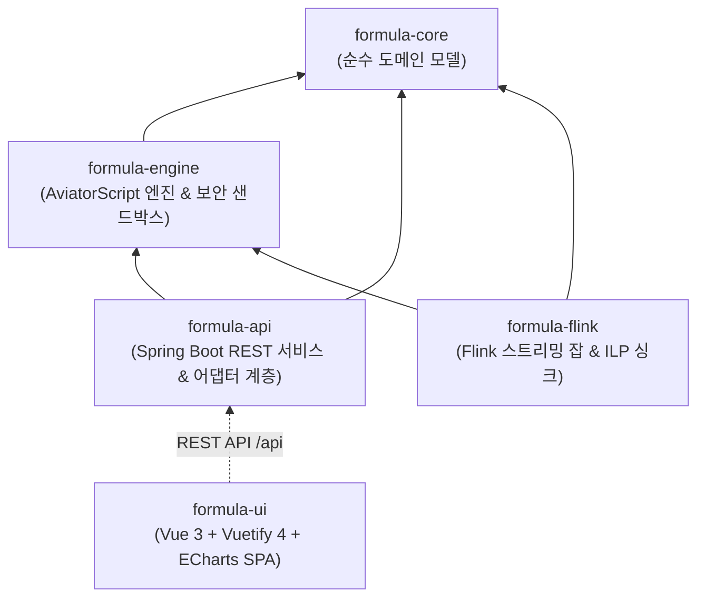
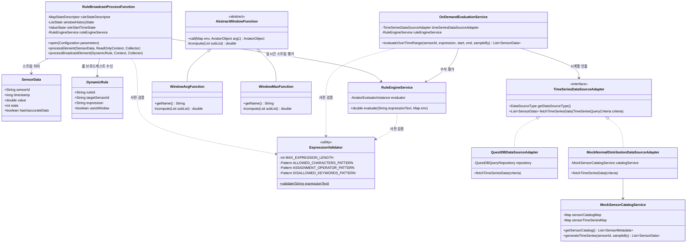
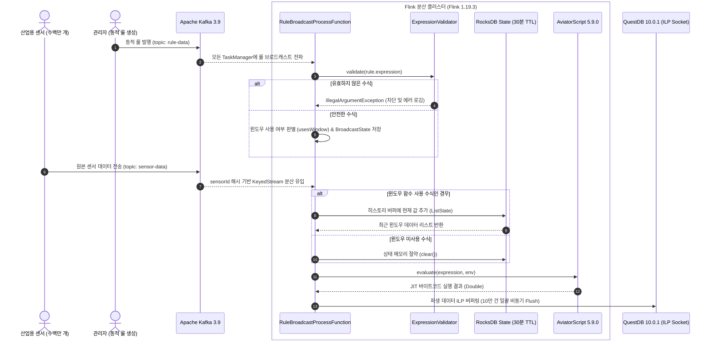
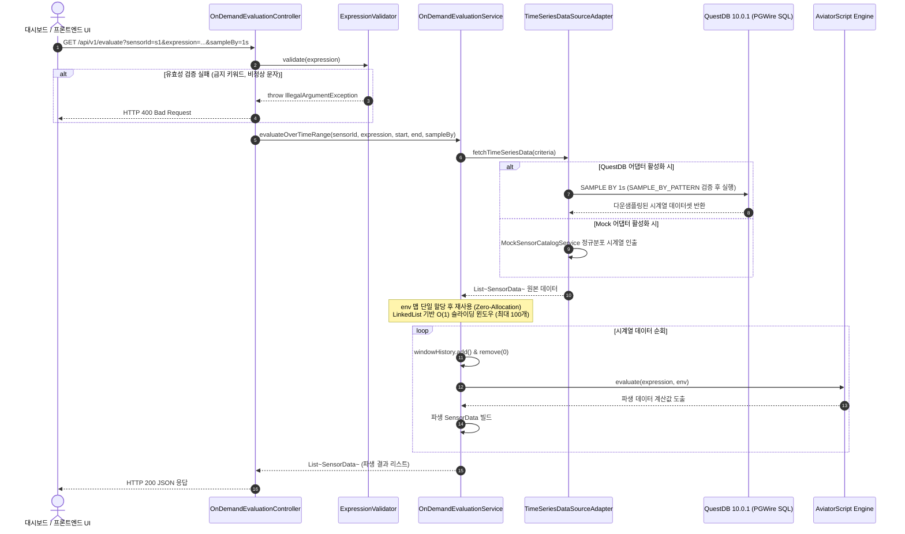
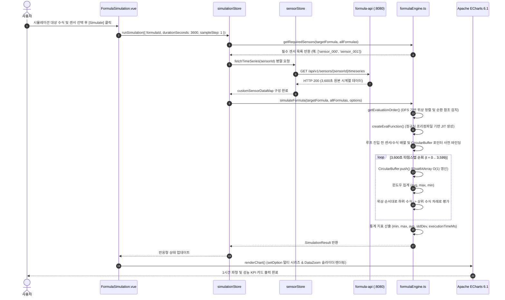
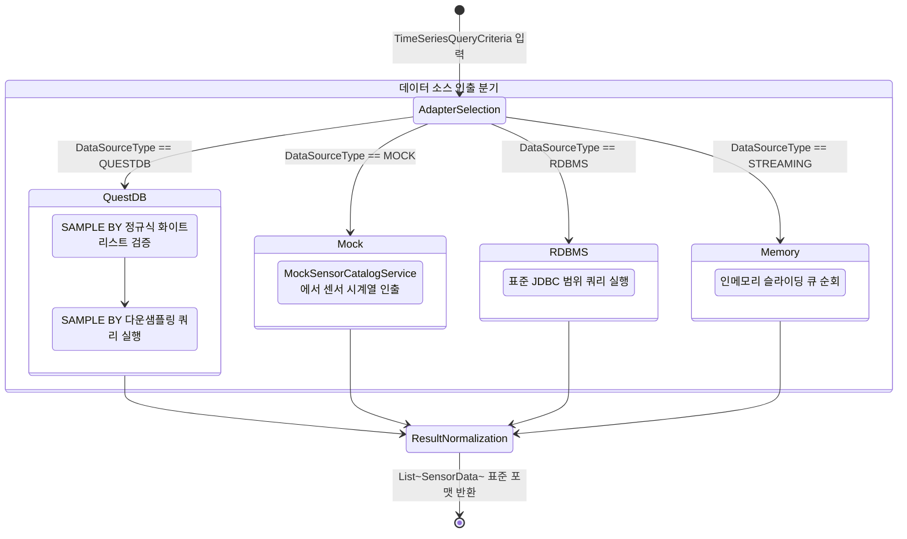
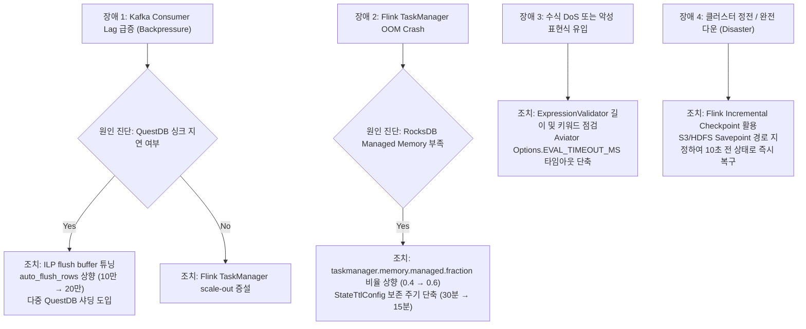

# 🚀 Formula Evaluator Service: 대규모 시스템 아키텍처 및 상세 가이드

본 문서는 대규모 IoT 시계열 데이터 평가 시스템(**Formula Evaluator Service**)의 아키텍처, Gradle 멀티 모듈 및 프론트엔드 모노레포 구조, 고성능 분산 처리 원리, 런타임 보안 샌드박스 및 운영 가이드를 총망라한 엔지니어링 기술 문서입니다.

---

## 1. 시스템 탄생 배경 및 설계 원칙

### 1.1 해결 과제 (High Cardinality & High Throughput)
* **초고속 유입량**: 산업 현장의 수백만 대 설비(Sensor)로부터 1초 이하 간격으로 대규모 원본 시계열 데이터가 쏟아져 들어옵니다.
* **동적 수식 평가**: 수십만 개의 사용자 정의 룰(Rule, 예: `value > 50 && window_avg(10) > 15`)을 시스템 중단 없이 런타임에 즉각 컴파일하여 파생 데이터를 계산해야 합니다.
* **보안 및 DoS 방어**: 런타임에 유입되는 사용자 정의 수식이 임의 코드 실행(Remote Code Execution), 시스템 클래스 로딩, 무한 루프, DoS 공격을 유발하지 않도록 철저한 샌드박스와 유효성 검증이 요구됩니다.
* **단일 RDBMS의 한계**: 건별 INSERT/SELECT에 의존하는 구조는 커넥션 고갈, 잠금(Lock) 경합, GC 오버헤드로 인해 초고속 스트리밍 환경에서 병목을 일으킵니다.

### 1.2 듀얼 패스(Dual-Path) 아키텍처 원칙
이러한 요구사항을 해결하기 위해 시스템의 처리 경로를 **실시간 스트리밍 경로(Streaming Path)**와 **온디맨드 즉석 평가 경로(On-Demand Path)**로 명확히 분리하고, 이를 시각화 및 검증할 수 있는 **인터랙티브 프론트엔드 UI(Formula UI)**를 결합하였습니다.

| 비교 항목 | 1. 실시간 스트리밍 경로 (Streaming Path) | 2. 온디맨드 즉석 평가 경로 (On-Demand Path) | 3. 인터랙티브 시뮬레이션 (Formula UI) |
| :--- | :--- | :--- | :--- |
| **핵심 엔진** | **Apache Flink 1.19.3** + RocksDB | **Spring Boot 3.5.16** + **QuestDB 10.0.1** | **Vue 3 + Vite 8** Client JIT Engine |
| **처리 대상** | 실시간 유입되는 무한 센서 스트림 | 과거 수억 건의 축적된 시계열 데이터 백테스팅 | 100개 가상 센서 및 사용자 정의 수식 DAG 시뮬레이션 |
| **처리 지연시간** | Sub-second (밀리초 단위 스트리밍) | 대시보드 인터랙티브 조회 (수십~수백 밀리초) | 86,400초(1일) 데이터 연산 약 500ms |
| **룰 전파 방식** | Flink **Broadcast State** (워커 전원 로컬 복제) | Spring 빈 주입 기반 런타임 JIT 평가 | Pinia 스토어 + DAG 위상 정렬 (Topological Sort) |
| **상태 저장소** | RocksDB StateBackend + 30분 State TTL | QuestDB 디스크 파티션 + LinkedList 슬라이딩 윈도우 | Float64Array 기반 `CircularBuffer` (Zero-Shift) |
| **데이터 소스** | Apache Kafka 3.9 (`sensor-data`, `rule-data`) | 플러그형 어댑터 (`MOCK`, `QUESTDB`, `RDBMS`) | 백엔드 `formula-api` Mock REST API (오프라인 Fallback) |
| **주요 장점** | 무중단 룰 적용, 수평적 스케일아웃, OOM 방지 | DB 레벨 SIMD 벡터화 다운샘플링 (`SAMPLE BY`) | 다단 합성 수식 실시간 검증 및 ECharts 시각화 |

```mermaid
flowchart TD
    subgraph DataSources["IoT 센서 및 관리자 입력"]
        SensorInput["산업용 센서 (수백만 개/초)"]
        RuleInput["관리자 동적 룰 정의 (수십만 개)"]
    end

    subgraph KafkaCluster["Apache Kafka 3.9 (Message Broker)"]
        SensorTopic["topic: sensor-data"]
        RuleTopic["topic: rule-data"]
    end

    SensorInput -->|대량 데이터 스트림| SensorTopic
    RuleInput -->|룰 메타데이터| RuleTopic

    subgraph StreamingPath["Path 1: 실시간 스트리밍 경로 (Apache Flink 1.19.3)"]
        BroadcastState["Rule Broadcast State (작업자 분산 전파)"]
        KeyedStream["KeyedStream by sensorId (수평 분산)"]
        RocksDBState["RocksDB State Backend (StateBackendOptions + 30분 TTL)"]
        SecFilter1["ExpressionValidator (수식 샌드박스 검증)"]
        AviatorJIT1["AviatorScript 5.9.0 JIT 컴파일러 (바이트코드 캐시)"]
        ILPSink["QuestDbIlpSink (비동기 배치 플러시, 10만건)"]

        RuleTopic -->|Broadcast| BroadcastState
        SensorTopic --> KeyedStream
        BroadcastState --> SecFilter1
        SecFilter1 --> AviatorJIT1
        KeyedStream & BroadcastState --> AviatorJIT1
        AviatorJIT1 <--> RocksDBState
        AviatorJIT1 -->|파생 데이터| ILPSink
    end

    subgraph StorageLayer["시계열 데이터 저장소"]
        QuestDB[("QuestDB 10.0.1 (ILP / PGWire SQL)")]
    end

    ILPSink -->|ILP TCP/HTTP| QuestDB

    subgraph OnDemandPath["Path 2: 온디맨드 즉석 평가 경로 (Spring Boot 3.5 REST API)"]
        Controller1["OnDemandEvaluationController (/api/v1/evaluate)"]
        Controller2["SensorController (/api/v1/sensors)"]
        Service["OnDemandEvaluationService (LinkedList Window & Map Reuse)"]
        SecFilter2["ExpressionValidator (보안 검증)"]
        Catalog["MockSensorCatalogService (100개 센서 메타 & 시계열 원천)"]
        AdapterLayer["TimeSeriesDataSourceAdapter 인터페이스"]
        QuestDBAdapter["QuestDBDataSourceAdapter (SAMPLE BY 화이트리스트 검증)"]
        MockAdapter["MockNormalDistributionDataSourceAdapter"]
        RDBMSAdapter["RdbmsDataSourceAdapter"]
        BufferAdapter["StreamingBufferDataSourceAdapter"]
        AviatorJIT2["AviatorScript Engine (보안 옵션 활성화)"]

        Controller1 --> SecFilter2
        SecFilter2 --> Service
        Controller2 --> Catalog
        Service --> AdapterLayer
        AdapterLayer --> QuestDBAdapter & MockAdapter & RDBMSAdapter & BufferAdapter
        MockAdapter --> Catalog
        QuestDBAdapter -->|PGWire SQL / SAMPLE BY| QuestDB
        Service --> AviatorJIT2
    end

    subgraph UIPath["Path 3: 인터랙티브 웹 UI (formula-ui : Vue 3 + Vuetify 4)"]
        ClientApp["Vite Dev Server (:3000)"]
        UI_Editor["FormulaEditor.vue (수식 편집 및 DAG 분석)"]
        UI_Sim["FormulaSimulation.vue (시뮬레이션 스튜디오)"]
        UI_Exp["SensorDataExplorer.vue (100개 센서 탐색)"]
        PiniaStores["Pinia Stores (formulaStore / sensorStore / simulationStore)"]
        ClientEngine["formulaEngine.ts (토큰 파서, DFS 사이클 감지, 위상 정렬)"]
        FastBuffer["CircularBuffer (Float64Array 링버퍼)"]
        Visualizer["Apache ECharts 6.1 (DataZoom + 멀티 시리즈)"]

        ClientApp --> UI_Editor & UI_Sim & UI_Exp
        UI_Editor & UI_Sim & UI_Exp --> PiniaStores
        PiniaStores --> ClientEngine
        ClientEngine --> FastBuffer
        ClientEngine --> Visualizer
    end

    UIPath ==>|1. 센서 카탈로그 & 시계열 조회 (/api/v1/sensors)| Controller2
    UIPath -.->|2. 온디맨드 평가 검증 (/api/v1/evaluate)| Controller1
```

---

## 2. 프로젝트 멀티 모듈 및 프론트엔드 아키텍처

프로젝트는 관심사 분리(Separation of Concerns)와 컴포넌트 재사용성을 극대화하기 위해 **4개의 백엔드 모듈**과 **1개의 모던 웹 프론트엔드 모듈**로 구성되어 있습니다.



### 모듈별 패키지 및 주요 클래스 파일 트리

```
formula-evaluator-service/
├── formula-core/                                # 순수 Java 도메인 모델 라이브러리
│   └── src/main/java/com/imoil/formula/domain/
│       ├── SensorData.java                      # 표준 시계열 데이터 모델 (sensorId, timestamp, value, state, hasInaccurateData)
│       └── DynamicRule.java                     # 동적 룰 정의 (ruleId, targetSensorId, expression, usesWindow)
├── formula-engine/                              # 수식 컴파일, 평가 및 보안 샌드박스
│   └── src/main/java/com/imoil/formula/engine/
│       ├── ExpressionValidator.java             # [보안] 수식 화이트리스트/블랙리스트 정규식 유효성 검증기
│       ├── RuleEngineConfig.java                # [보안] AviatorEvaluatorInstance 빈 설정 (클래스 차단, 기능 제한, 타임아웃)
│       ├── RuleEngineService.java               # 수식 JIT 컴파일 및 바이트코드 캐시 실행 서비스
│       └── functions/
│           ├── AbstractWindowFunction.java      # 윈도우 집계 함수 공통 방어 추상 클래스
│           ├── WindowAvgFunction.java           # window_avg(N) 이동 평균 커스텀 함수
│           └── WindowMaxFunction.java           # window_max(N) 이동 최대값 커스텀 함수
├── formula-api/                                 # Spring Boot REST 애플리케이션 & 데이터소스 어댑터
│   └── src/main/java/com/imoil/formula/
│       ├── FormulaEvaluatorApplication.java     # Spring Boot 메인 엔트리포인트 (@EnableScheduling)
│       ├── api/
│       │   ├── OnDemandEvaluationController.java # GET /api/v1/evaluate
│       │   └── SensorController.java            # GET /api/v1/sensors (100개 센서 카탈로그 & 시계열 조회)
│       ├── config/
│       │   ├── QuestDBConfig.java               # QuestDB Sender 클라이언트 & No-Op Fallback Dynamic Proxy
│       │   └── TimeSeriesDataSourceConfig.java  # DataSourceType 조건부 Bean 구성
│       ├── datasource/
│       │   ├── DataSourceType.java              # QUESTDB, RDBMS, STREAMING_BUFFER, MOCK
│       │   ├── TimeSeriesDataSourceAdapter.java # 플러그형 시계열 데이터소스 인터페이스
│       │   ├── TimeSeriesQueryCriteria.java     # 쿼리 파라미터 DTO (sensorId, range, sampleBy)
│       │   ├── MockNormalDistributionDataSourceAdapter.java # 100개 센서 정규분포 시계열 어댑터
│       │   ├── QuestDBDataSourceAdapter.java    # QuestDB PGWire SQL 연동 어댑터
│       │   ├── RdbmsDataSourceAdapter.java      # JDBC 기반 범용 RDBMS 어댑터
│       │   └── StreamingBufferDataSourceAdapter.java # 인메모리 링버퍼 어댑터
│       ├── repository/
│       │   └── QuestDBQueryRepository.java      # [보안] SAMPLE BY 화이트리스트 정규식 검증 및 SQL 바인딩
│       └── service/
│           ├── MockSensorCatalogService.java    # [단일 진실 공급원] 100개 센서 메타데이터 및 1시간 시계열 생성
│           ├── OnDemandEvaluationService.java   # [성능] LinkedList 윈도우 & Map 재사용 기반 온디맨드 평가기
│           ├── QuestDBIngestionService.java     # 스레드 안전 ILP 배치 인제스천 서비스 (ChronoUnit.NANOS)
│           └── QuestDBRetentionService.java     # [보안] 파티션명 검증 기반 DROP PARTITION 일별 자동 정리
├── formula-flink/                               # Apache Flink 분산 스트리밍 처리 잡
│   └── src/main/java/com/imoil/formula/flink/
│       ├── AppConstants.java                    # Kafka 토픽, 파라미터 키 및 기본 설정값 상수
│       ├── StreamingEvaluatorJob.java           # Flink Job 메인 (StateBackendOptions 설정, Broadcast 파이프라인)
│       ├── RuleBroadcastProcessFunction.java    # KeyedBroadcastProcessFunction (BroadcastState, RocksDB TTL, 메트릭)
│       └── QuestDbIlpSink.java                  # 고속 QuestDB ILP 소켓 싱크 (배치/주기적 Flush)
└── formula-ui/                                  # Vue 3 + Vuetify 4 + TypeScript 웹 SPA
    └── src/
        ├── components/
        │   ├── FormulaList.vue                  # 수식 목록 조회, 검색, 필터링 및 관리
        │   ├── FormulaEditor.vue                # 수식 작성, 토큰 인서트, 실시간 DAG 사이클 분석
        │   ├── FormulaSimulation.vue            # [성능] 1시간 시계열 시뮬레이션 및 ECharts 차트 시각화
        │   └── SensorDataExplorer.vue           # 백엔드 연동 100개 센서 탐색기 및 파형 뷰어
        ├── services/
        │   ├── circularBuffer.ts                # [성능] Float64Array 기반 O(1) 링 버퍼 구현체
        │   ├── formulaEngine.ts                 # [성능] 프리컴파일 정규식, 위상 정렬, 바인딩 사전 추출 시뮬레이터
        │   ├── apiClient.ts                     # formula-api REST 연동 클라이언트
        │   └── sensorDataGenerator.ts           # 오프라인 단독 구동용 Fallback 생성기
        ├── stores/
        │   ├── formulaStore.ts                  # 수식 CRUD 및 localStorage 영속화 Pinia 스토어
        │   ├── sensorStore.ts                   # 백엔드 센서 카탈로그 & 시계열 캐시 Pinia 스토어
        │   └── simulationStore.ts               # 시뮬레이션 실행 및 결과 제어 Pinia 스토어
        └── types/
            ├── formula.ts                       # 수식 및 시뮬레이션 결과 타입 정의
            └── sensor.ts                        # 센서 메타데이터 및 데이터포인트 타입 정의
```

### 모듈별 책임 및 주요 기술 스택

| 모듈명 | 기술 스택 | 핵심 역할 및 기능 |
| :--- | :--- | :--- |
| **`formula-core`** | Java 25, Lombok | 프레임워크 독립적인 순수 시계열 및 룰 도메인 모델 정의 (`SensorData`, `DynamicRule`) |
| **`formula-engine`** | AviatorScript 5.9.0, Spring Context | 동적 수식 JIT 바이트코드 컴파일, 코드 인젝션 방어(`ExpressionValidator`), 보안 샌드박스, 윈도우 커스텀 함수(`window_avg`, `window_max`) |
| **`formula-api`** | Spring Boot 3.5.16, Spring Data JPA, QuestDB Client 1.3.9 | 온디맨드 수식 평가 REST API, 100개 센서 카탈로그 API(Single Source of Truth), 플러그형 시계열 어댑터 계층, QuestDB ILP 수집 및 자동 파티션 관리 |
| **`formula-flink`** | Apache Flink 1.19.3, RocksDB, Kafka Connector 3.3.0 | 분산 스트리밍 파이프라인, `BroadcastState` 무중단 룰 전파, State TTL 기반 OOM 방지, QuestDB ILP 고속 비동기 적재 |
| **`formula-ui`** | Vite 8, Vue 3.5, Vuetify 4.2, ECharts 6.1, Pinia, TypeScript | 클라이언트 동적 수식 에디터, 실시간 DAG 위상 정렬 및 순환 참조 방지, `CircularBuffer` 기반 초고속 시뮬레이션, 백엔드 연동 시각화 |

---

## 3. 핵심 도메인 및 클래스 연관 구조



---

## 4. 고성능 비기능 요구사항(NFR) 및 보안 해결 메커니즘

### 🔒 4.1 엄격한 수식 보안 샌드박스 (Code Injection & DoS 방어)
사용자가 임의로 입력하는 동적 수식은 보안상 가장 취약한 지점입니다. 본 시스템은 3중 방어 메커니즘을 적용합니다.

1. **`ExpressionValidator` 사전 정적 분석**:
   - **문자열 길이 제한**: 500자 이하로 제한하여 비정상적으로 거대한 페이로드 사전 차단.
   - **허용 문자 정규식 화이트리스트**: 영문, 숫자, 밑줄, 공백, 사칙/논리/삼항 연산자(`+ - * / % ? : > < = ! & |`), 괄호, 쉼표, 마침표만 허용.
   - **단독 대입 연산자(`=`) 차단**: 상태 변경 공격 및 변수 덮어쓰기 방지 (`==`, `!=`, `>=`, `<=` 제외).
   - **위험 키워드 블랙리스트 차단**: `Class`, `System`, `Runtime`, `Process`, `ProcessBuilder`, `exec`, `eval`, `load`, `import`, `new`, `fn`, `let`, `def`, `while`, `for`, `try`, `catch`, `throw`, `java`, `org`, `com` 등을 완전 차단.
2. **Aviator 런타임 클래스 격리 (`RuleEngineConfig`)**:
   - `instance.setOption(Options.ALLOWED_CLASS_SET, Collections.emptySet())`: 모든 Java 리플렉션 및 클래스 접근을 원천 차단.
   - `Feature.NewInstance`, `Feature.StaticMethods`, `Feature.StaticFields`, `Feature.Module` 등 위험 기능 일체 비활성화.
3. **루프 및 타임아웃 제한**:
   - `MAX_LOOP_COUNT = 1000`, `EVAL_TIMEOUT_MS = 5000L` 설정을 통해 무한 루프 DoS 공격 방지.

### 🔒 4.2 SQL Injection 및 DDL Injection 방어
* **QuestDB SAMPLE BY 정규식 화이트리스트 검증**:
  - `SAMPLE BY` 구문은 SQL Prepared Statement로 파라미터 바인딩이 지원되지 않는 TSDB 전용 절입니다.
  - `QuestDBQueryRepository`는 정규식 `^[1-9][0-9]*(?:s|m|h|d|w|ms|M|y)$` 패턴에 매칭되는 유효한 시간 간격 문자열만 허용하여 SQL 인젝션을 원천 봉쇄합니다.
* **DROP PARTITION 명칭 포맷 검증**:
  - `QuestDBRetentionService`에서 매일 만료 파티션을 정리할 때 파티션명이 정확히 `^\d{4}-\d{2}-\d{2}$` 날짜 형식인지 검증 후 DDL을 실행합니다.

### ⚡ 4.3 온디맨드 수식 평가 고속화 (Zero-Allocation Loop & O(1) Window)
* **`LinkedList` 슬라이딩 윈도우**: `OnDemandEvaluationService`에서 윈도우 이력을 보관할 때 `ArrayList` 대신 `LinkedList`를 채택하여 `remove(0)` 시 $O(N)$ 메모리 시프트를 없애고 $O(1)$로 처리합니다.
* **평가 환경 Map 객체 재사용**: 시계열 루프 내부에서 매 행마다 `HashMap`을 새로 생성하던 오버헤드를 제거하고, 루프 외부에 단일 `env` 맵을 사전 할당하여 값만 갱신함으로써 JVM GC 가비지 발생을 극소화했습니다.

### ⚡ 4.4 프론트엔드 시뮬레이션 초고속화 (CircularBuffer & Binding Extraction)
* **`Float64Array` 기반 `CircularBuffer`**: 브라우저 자바스크립트 엔진의 배열 `shift()`에 따른 요소 재배치 오버헤드를 완전히 제거하기 위해 고정 크기 TypedArray와 모듈로 연산 포인터를 사용하는 `CircularBuffer`를 자체 구현하였습니다.
* **시뮬레이션 루프 바인딩 사전 추출 (Pre-extraction)**: 3,600초~86,400초 시계열 순회 루프 내부에서 `Map.get()`을 반복 호출하지 않도록, 루프 진입 전 센서 배열과 버퍼 포인터를 배열로 사전 캐싱하여 루프 내부에서는 정수 인덱스로 초고속 접근합니다.
* **정규식 모듈 스코프 프리컴파일**: `formulaEngine.ts` 내의 수식 변환 정규식(`RE_WINDOW_AVG` 등)을 전역 모듈 스코프에서 사전 컴파일하여 매 컴파일 시의 정규식 파싱 오버헤드를 제거했습니다.
* **성능 벤치마크**: 86,400초(1일) 데이터 포인트에 대해 5회 반복 시뮬레이션 평균 수행 시간이 **520ms** 수준으로 측정되었습니다.

### ⚡ 4.5 Flink 분산 스트리밍 및 RocksDB 메모리 보호
* **Configuration 기반 State Backend 설정**: Flink 1.19+ 표준에 맞춰 Deprecated된 `setStateBackend` 대신 `StateBackendOptions.STATE_BACKEND = "rocksdb"` 및 `CheckpointingOptions.INCREMENTAL_CHECKPOINTS = true`를 구성했습니다.
* **Zero External Lookup (Broadcast State)**: 센서 데이터 1건마다 외부 DB나 Redis를 조회하지 않고, Kafka 룰 토픽을 TaskManager 전원 로컬 메모리에 동기화하여 지연 시간을 극소화합니다.
* **RocksDB State TTL**: `retentionTimeMinutes` (기본 30분) TTL을 부여하여 만료된 윈도우 상태는 백그라운드 컴팩션 과정에서 안전하게 정리됩니다.
* **윈도우 미사용 룰 메모리 절약**: 수식에 `window_` 또는 `previous_` 함수가 없는 경우 상태 히스토리를 즉시 클리어(`windowHistoryState.clear()`)하여 메모리 낭비를 방지합니다.
* **QuestDB ILP 비동기 배치 싱크**: Flink 워커에서 `auto_flush_interval=1000; auto_flush_rows=100000;` 조건으로 소켓 버퍼링하여 대규모 데이터를 고속 적재합니다.

---

## 5. 상세 실행 시퀀스 (Execution Flows)

### 5.1 실시간 스트리밍 경로 (Streaming Path)



---

### 5.2 온디맨드 즉석 평가 경로 (On-Demand Path)



---

### 5.3 인터랙티브 프론트엔드 UI 시뮬레이션 경로 (Formula UI Path)



---

## 6. 플러그형 시계열 데이터 소스 아키텍처 (DataSource Adapters)

시스템은 엔터프라이즈 환경의 다양한 저장소 요구사항에 유연하게 대응하기 위해 **어댑터 패턴(Adapter Pattern)**을 적용했습니다.

| 어댑터 구현체 | DataSourceType | 지원 데이터 소스 | 주요 활용 시나리오 및 동작 특성 |
| :--- | :--- | :--- | :--- |
| **`QuestDBDataSourceAdapter`** | `QUESTDB` | QuestDB 10.0.1 (기본값) | 대규모 시계열 온디맨드 조회. `SAMPLE BY` 시간축 다운샘플링으로 네트워크 I/O 최소화, 정규식 화이트리스트로 인젝션 방어 |
| **`MockNormalDistributionDataSourceAdapter`** | `MOCK` | 인메모리 가상 센서 카탈로그 | 도커/외부 DB 없이 단독 구동. 100개 센서의 평균($\mu$), 표준편차($\sigma$) 기반 3,600건 가우시안 정규분포 시계열 원천 제공 |
| **`RdbmsDataSourceAdapter`** | `RDBMS` | PostgreSQL, Oracle, MySQL | 전통적인 RDBMS 환경 연동. Spring JDBC 기반 `BETWEEN` 범위 쿼리 |
| **`StreamingBufferDataSourceAdapter`** | `STREAMING` | JVM 인메모리 링 버퍼 | 초저지연 테스트 및 캐시 계층. `ConcurrentHashMap` 기반 최근 이벤트 즉석 인출 |



---

## 7. 커스텀 수식 함수 개발 가이드 (Extension Guide)

`formula-engine` 모듈에 새로운 도메인 특화 수식 함수(예: 최근 N개 데이터의 변화율 `window_rate(N)`)를 안전하게 추가하는 방법입니다.

### 1단계: `AbstractWindowFunction`을 상속하는 함수 클래스 구현
`formula-engine/src/main/java/com/imoil/formula/engine/functions/` 디렉터리에 클래스를 생성하고 `compute(List<Double> subList)`를 구현합니다. 공통 예외 처리와 인자 유효성 검사는 부모 클래스에서 자동으로 처리됩니다.

```java
package com.imoil.formula.engine.functions;

import com.googlecode.aviator.runtime.type.AviatorDouble;
import org.springframework.stereotype.Component;

import java.util.List;

@Component
public class WindowRateFunction extends AbstractWindowFunction {

    @Override
    public String getName() {
        return "window_rate"; // 수식에서 사용할 함수 키워드
    }

    @Override
    protected double compute(List<Double> subList) {
        if (subList.size() < 2) {
            return 0.0;
        }
        double first = subList.get(0);
        double last = subList.get(subList.size() - 1);
        if (first == 0.0) {
            return 0.0;
        }
        return (last - first) / first * 100.0;
    }
}
```

### 2단계: 엔진 빈 설정 등록
[`RuleEngineConfig.java`](file:///C:/Users/imoil/repo/formula-evaluator-service/formula-engine/src/main/java/com/imoil/formula/engine/RuleEngineConfig.java)에 새로 만든 함수 빈을 주입받아 바인딩합니다.

```java
@Configuration
public class RuleEngineConfig {

    @Bean
    public AviatorEvaluatorInstance aviatorEvaluatorInstance(
            WindowAvgFunction windowAvgFunction,
            WindowMaxFunction windowMaxFunction,
            WindowRateFunction windowRateFunction) { // 신규 함수 추가
        
        AviatorEvaluatorInstance instance = AviatorEvaluator.newInstance();
        instance.setCachedExpressionByDefault(true);
        
        // 보안 설정 유지 ...
        
        // 함수 등록
        instance.addFunction(windowAvgFunction);
        instance.addFunction(windowMaxFunction);
        instance.addFunction(windowRateFunction); // 바인딩 등록

        return instance;
    }
}
```

---

## 8. 대규모 인프라 사이징 및 장애 대응 (Capacity Planning & DR)

### 8.1 인프라 권장 사이징 매트릭스 (기준: 원본 센서 500만 개/초, 룰 50만 개)

| 인프라 컴포넌트 | 최소 권장 사양 | 디스크 스토리지 | 핵심 튜닝 파라미터 |
| :--- | :--- | :--- | :--- |
| **Apache Kafka** | 10~15대 (각 8 Core, 32GB RAM) | NVMe SSD (500MB/s+ 쓰기) | 토픽 파티션 512개 이상 분할, `compression.type=lz4` |
| **Flink TaskManager** | 15~20대 (각 16 Core, 64GB RAM) | 워커당 1~2TB NVMe SSD | RocksDB Off-Heap 비율 60%, G1GC 적용, State TTL 30분 |
| **QuestDB Master** | 단독 서버 (32 Core, 128GB RAM) | 고속 엔터프라이즈 NVMe | `cairo.max.uncommitted.rows=200000`, 자동 일별 파티션 드롭 |
| **Spring Boot API** | 4~6대 로드밸런싱 (각 4 Core, 8GB) | Stateless | 가상 스레드(Virtual Threads) 활성화, 커넥션 풀 50 |

### 8.2 핵심 운영 장애 시나리오 및 해결 절차


