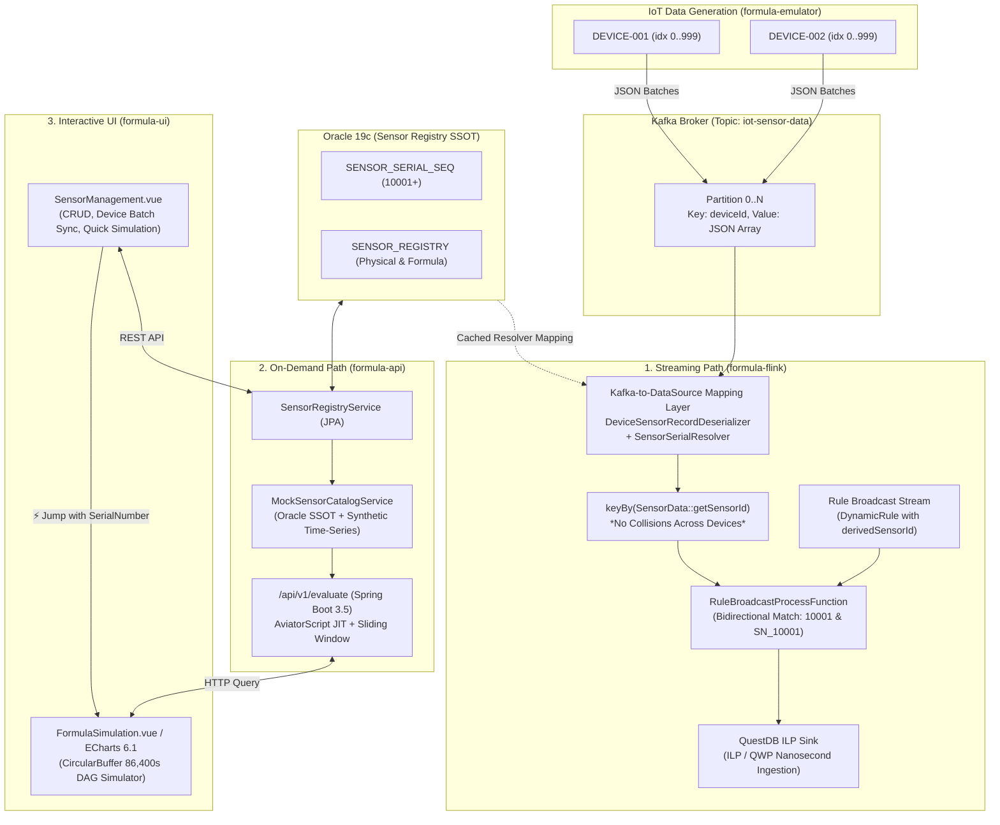

# **🚀 대규모 IoT 시계열 데이터 평가 시스템 (Dual-Path Architecture) - Development Harness**

## **1. 프로젝트 개요 (Project Overview)**

본 프로젝트는 1초 간격으로 유입되는 수백만 개의 IoT 센서 데이터를 지연 없이 수집하고, 사용자가 정의한 수십만 개의 복잡한 수식(Formula)과 윈도우 함수(Window Functions)를 동적으로 평가하여 파생 데이터를 생성하는 고성능 분산 처리 시스템입니다.  
**핵심 과제:**

* **단일 일련번호(Serial Number) 기반 통합 센서 관리 체계**: 여러 IoT 장치(예: `DEVICE-001`, `DEVICE-002`)에서 동일한 로컬 `sensorIndex`(0 ~ 999)를 전송할 때 발생하는 키 충돌을 원천 차단하고, 온디멘드(On-Demand)와 Flink 실시간 스트리밍 전체에 걸쳐 물리 센서와 수식 센서를 단일 고유 일련번호(`10001+`)로 통합 관리.
* **Oracle 19c 영속성 저장소**: `SENSOR_REGISTRY` 테이블 및 `SENSOR_SERIAL_SEQ` 시퀀스(시작값 10001)를 활용한 센서 메타데이터와 파생 수식 센서 중앙 집중 관리.
* **극단적인 카디널리티(High Cardinality) 환경에서의 초고속 데이터 삽입 및 조회**: QuestDB ILP QWP 초고속 수집 및 PostgreSQL Wire 조회.
* **런타임 동적 룰 평가**: Flink 1.19.3 Broadcast State 및 RocksDB StateBackend를 통한 무중단 룰 배포 및 평가.
* **수식 보안 샌드박스(`ExpressionValidator`)**: 임의 코드 실행(RCE) 및 무한 루프 DoS 공격을 원천 차단하는 정적 분석기.
* **중첩 함수 및 윈도우 연산 지원**: 과거 슬라이딩 윈도우 기반 집계 함수(`window_avg`, `window_max`).
* **관심사 분리(SoC)를 보장하는 Gradle 멀티 모듈 및 프론트엔드 모노레포 아키텍처**.

---

## **2. 핵심 아키텍처: 듀얼 패스 실행 및 단일 일련번호 매핑 계층**

시스템의 평가 로직은 성능과 실시간성을 모두 충족하기 위해 세 가지 독립적인 경로로 분리하여 설계 및 구현합니다.



1. **스트리밍 평가 경로 (Streaming Path - Apache Flink 1.19.3 & Kafka 3.9.2)**  
   * **Kafka-to-DataSource 매핑 계층**: 카프카 `ConsumerRecord` 수신 시점([`DeviceSensorRecordDeserializer`](file:///C:/Users/imoil/repo/formula-evaluator-service/formula-flink/src/main/java/com/imoil/formula/flink/DeviceSensorRecordDeserializer.java))에서 [`SensorSerialResolver`](file:///C:/Users/imoil/repo/formula-evaluator-service/formula-core/src/main/java/com/imoil/formula/domain/SensorSerialResolver.java)를 호출하여 `(deviceId, sensorIndex)`를 단일 고유 일련번호(`10001+`)로 변환.
   * `keyBy(SensorData::getSensorId)`에서 장치 간 센서 인덱스 중복(예: `DEVICE-001#0` vs `DEVICE-002#0`)으로 인한 상태 오염 원천 차단.
   * `RuleBroadcastProcessFunction`을 통해 룰 브로드캐스트 스트림과 결합, AviatorScript로 룰 평가 후 `derivedSensorId`(파생 수식 센서 일련번호)로 QuestDB ILP 싱크에 적재.
   * RocksDB StateBackend 및 30분 State TTL 적용.

2. **실시간 조회 평가 경로 (On-Demand Path - Spring Boot 3.5 & QuestDB 10.0.1 / Oracle 19c)**  
   * Oracle 19c `SENSOR_REGISTRY`에 등록된 일련번호를 기준으로 온디멘드 즉시 평가 (`GET /api/v1/evaluate`).
   * [`MockSensorCatalogService`](file:///C:/Users/imoil/repo/formula-evaluator-service/formula-api/src/main/java/com/imoil/formula/service/MockSensorCatalogService.java)가 Oracle DB를 단일 진실 공급원(SSOT)으로 조회하여 일련번호(`10001`, `SN_10001`) 기반의 원본 시계열 데이터 및 메타데이터를 프론트엔드에 제공.
   * `LinkedList` 기반 $O(1)$ 슬라이딩 윈도우 및 환경 맵 객체 재사용(Zero-Allocation)을 통한 GC 최적화.

3. **인터랙티브 웹 UI 경로 (Interactive UI Path - Vue 3 & Vite 8)**  
   * [`SensorManagement.vue`](file:///C:/Users/imoil/repo/formula-evaluator-service/formula-ui/src/components/SensorManagement.vue): 물리 센서 및 수식 센서 CRUD, IoT 장치 1,000개 센서 일괄 동기화 모달, 실시간 일련번호 프리뷰.
   * **"⚡ On-Demand Simulation"** 기능: 센서 목록에서 수식 센서 선택 시 일련번호 및 수식 표현식을 온디멘드 시뮬레이션 탭으로 자동 바인딩하여 즉시 차트 확인.
   * `Float64Array` 기반 `CircularBuffer`로 86,400초 시계열 고속 브라우저 시뮬레이션.

---

## **3. 프로젝트 멀티 모듈 구조 (Multi-Module Layout)**

```
formula-evaluator-service/
├── formula-core/      # 순수 도메인 모델 (SensorData, DynamicRule, DeviceSensorKey, SensorSerialResolver)
├── formula-engine/    # AviatorScript 5.9.0 엔진, 보안 검증(ExpressionValidator), 윈도우 집계 함수
├── formula-api/       # Spring Boot 3.5 웹 서비스, Oracle 19c 센서 레지스트리, 플러그형 DataSource, 온디멘드 평가
├── formula-flink/     # Flink 1.19.3 분산 스트리밍 잡, Kafka 역직렬화 일련번호 매핑 계층, QuestDB ILP 싱크
├── formula-emulator/  # 대규모 IoT 장치 센서 에뮬레이터 (1,000개 센서, 독립 주기 변동, JSON 배열 카프카 발송)
└── formula-ui/        # Vite 8 + Vue 3 + Vuetify 4 SPA, 통합 센서 레지스트리 관리 UI, 초고속 시뮬레이터
```

---

## **4. 기술 스택 및 버전 규약 (Technology Stack & Versions)**

* **Language:** Java 25 (OpenJDK 25.0.1 LTS Toolchain), TypeScript 5.8
* **Build Tool:** Gradle 9.8.0 (Version Catalog: `gradle/libs.versions.toml`), pnpm 12
* **Framework:** Spring Boot 3.5.16 (`io.spring.dependency-management` 1.1.7)
* **Metadata Database (RDBMS):** Oracle 19c Enterprise / Standard (`com.oracle.database.jdbc:ojdbc11`)
  - 컨테이너: `gvenzl/oracle-free:19-slim-faststart` (포트 1521, SID `ORCLCDB`, PDB `ORCLPDB1`)
  - 테이블: `SENSOR_REGISTRY`, 시퀀스: `SENSOR_SERIAL_SEQ` (시작값 10001, CACHE 1000)
  - 로컬 Mock 프로파일 시 H2 인메모리 호환 모드 자동 지원
* **Time-Series Database (TSDB):** QuestDB 10.0.1  
  - 쓰기: QuestDB Official Client 1.3.9 (`org.questdb:questdb-client:1.3.9`, ILP / QWP 고속 스트리밍 지원, `ChronoUnit.NANOS`)  
  - 읽기: PostgreSQL Wire (Spring Data JPA / JdbcTemplate, Driver `org.postgresql:42.7.14`)  
* **Streaming Engine:** Apache Flink 1.19.3  
  - Connector: `org.apache.flink:flink-connector-kafka:3.3.0-1.19`  
  - State Backend: RocksDB StateBackend (`StateBackendOptions.STATE_BACKEND = "rocksdb"`)  
* **Expression Engine:** AviatorScript 5.9.0 (`io.github.aviatorscript:aviator:5.9.0`)
  - 동적 바이트코드 컴파일, 화이트리스트 샌드박스, `ALLOWED_CLASS_SET = emptySet()` 클래스 격리  
  - `MAX_LOOP_COUNT = 1000`, `EVAL_TIMEOUT_MS = 5000L`
* **Frontend:** Vue 3.5, Vuetify 4.2.4, Vite 8.3, Apache ECharts 6.1, Pinia 4.0.3, Vitest 5.0.3
* **Testing & CI/CD:** Podman Compose, Testcontainers 1.21.4 (`org.testcontainers.kafka.ConfluentKafkaContainer`, `disabledWithoutDocker = true`), Vitest
* **Message Broker:** Apache Kafka 3.9.2 (Sensor Data & Rule Stream)

---

## **5. 핵심 구현 지침 (Implementation Directives)**

1. **단일 일련번호(Serial Number) 매핑 및 충돌 방지:**
   * `formula-core`의 [`SensorSerialResolver`](file:///C:/Users/imoil/repo/formula-evaluator-service/formula-core/src/main/java/com/imoil/formula/domain/SensorSerialResolver.java)는 순수 Java로 작성되어 프레임워크 종속성(`@Slf4j`, Spring 등)이 없어야 하며, Flink 태스크 매니저 환경에서 경량 고속 동작을 보장합니다.
   * `DeviceSensorRecordDeserializer`는 카프카 컨슈머 레코드 파싱 단계에서 `SensorSerialResolver`를 호출하여 Flink의 모든 후속 스트림 처리가 일련번호 기반으로만 이루어지도록 강제합니다.
   * `DynamicRule`은 `derivedSensorId` 필드를 포함하며, `RuleBroadcastProcessFunction`은 룰 파싱 시 `10001`과 `SN_10001`을 양방향 등록하여 표현식 평가 시 유연성을 제공합니다.
2. **표현식 엔진 최적화 및 보안 샌드박스:**
   * 모든 수식은 평가 전에 반드시 `ExpressionValidator.validate()`를 통과해야 합니다. 길이 500자 제한, 화이트리스트 문자 및 연산자 검증, 단독 대입문(`=`) 금지, 시스템/리플렉션 키워드 차단.
   * `RuleEngineConfig`에서 `Options.ALLOWED_CLASS_SET`을 빈 집합으로 지정하여 클래스 로딩을 차단하고, 무한 루프 DoS를 방지합니다.
   * `window_avg`, `window_max` 등 커스텀 윈도우 로직은 `AbstractWindowFunction`을 상속받아 안전하게 슬라이스 계산을 수행합니다.
3. **데이터베이스 I/O 및 인젝션 방어:**
   * QuestDB로 데이터를 쓸 때는 공식 최신 ILP/QWP 클라이언트(`questdb-client:1.3.9`)를 사용하여 비동기/배치 방식으로 전송합니다 (`auto_flush_rows=100000`, `ChronoUnit.NANOS`).
   * `QuestDBQueryRepository`의 `SAMPLE BY` 구문은 정규식 패턴(`^[1-9][0-9]*(?:s|m|h|d|w|ms|M|y)$`)으로 엄격히 검증 후 바인딩합니다.
   * Oracle 19c `SENSOR_REGISTRY`의 `(DEVICE_ID, DEVICE_SENSOR_INDEX)`에는 유니크 인덱스를 설정하여 물리 센서의 중복 매핑을 방지합니다.
4. **프론트엔드 고성능 아키텍처 및 스토어 통합:**
   * `formula-ui`의 `sensorRegistryStore`는 REST API(`/api/v1/registry/sensors`)와 통신하여 센서 메타데이터를 관리합니다.
   * `SensorManagement.vue`에서 시뮬레이션 버튼 클릭 시 `sensorStore.selectSensor()` 및 `sensorStore.setExpression()`을 연쇄 호출하고 탭 전환을 트리거하여 일원화된 사용자 경험을 제공합니다.
5. **테스트 안정성:**
   * Flink Keyed Broadcast Process Function 테스트 시 `ProcessFunctionTestHarnesses.forKeyedBroadcastProcessFunction`의 4번째 인자로 브로드캐스트 상태 디스크립터(`RuleBroadcastProcessFunction.RULE_STATE_DESCRIPTOR`)를 반드시 전달하여 상태 미등록 예외를 방지합니다.
