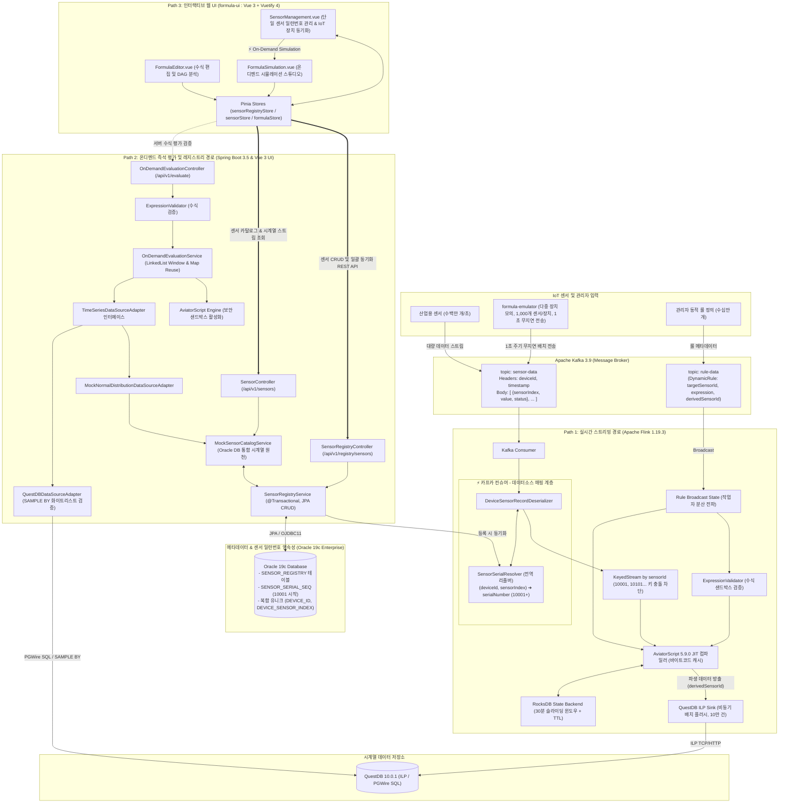
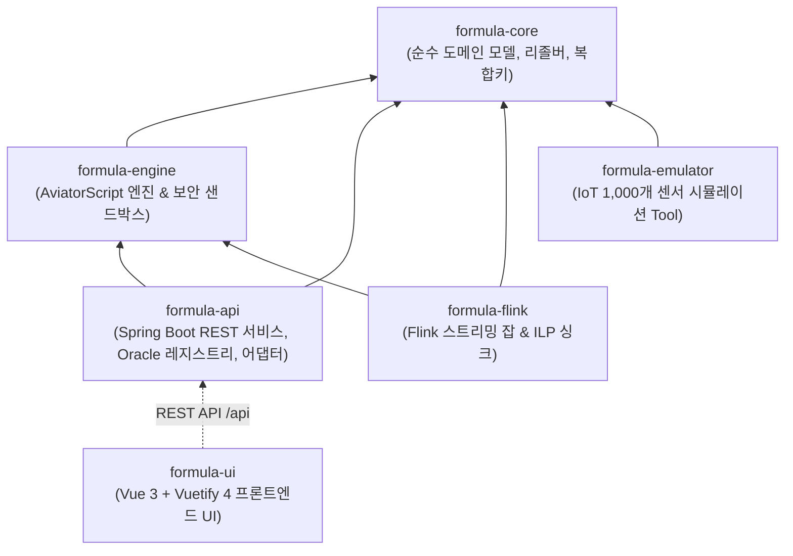

# 🚀 대규모 IoT 시계열 데이터 평가 시스템 (Formula Evaluator Service)

[](https://adoptium.net/)
[](https://spring.io/projects/spring-boot)
[](https://gradle.org/)
[](https://flink.apache.org/)
[](https://questdb.io/)
[](https://www.oracle.com/database/)
[](https://github.com/killme2008/aviatorscript)
[](https://vuejs.org/)
[](https://vuetifyjs.com/)

본 프로젝트는 1초 이하 간격으로 유입되는 수백만 대의 IoT 센서 시계열 데이터를 지연 없이 수집하고, 사용자가 정의한 동적 수식(Formula)과 윈도우 집계 로직을 즉각 컴파일하여 파생 데이터를 계산하는 **고성능 듀얼 패스(Dual-Path) 분산 처리 시스템**입니다.

모든 IoT 물리 센서와 수식 센서는 **Oracle 19c 기반의 단일 일련번호 체계(`serialNumber: 10001+`)**로 통합 관리되며, 카프카 컨슈머와 Flink DataSource 사이의 매핑 계층을 통해 다중 장치 센서 인덱스 충돌을 원천 차단합니다.

---

## 🏛️ 시스템 아키텍처 개요

### 1. 듀얼 패스 실행 아키텍처 (Dual-Path Architecture)

시스템은 실시간성과 분석 성능을 극대화하기 위해 두 가지 상호 보완적인 처리 경로와 인터랙티브 웹 UI를 제공합니다.



---

## 📦 멀티 모듈 구조 (Multi-Module Architecture)

프로젝트는 명확한 관심사 분리(SoC)와 재사용성을 고려하여 5개의 백엔드 모듈과 1개의 프론트엔드 모듈로 구성되어 있습니다.



### 모듈별 책임 및 구성

| 모듈명 | 유형 | 주요 기술 | 책임 및 기능 |
| :--- | :--- | :--- | :--- |
| **`formula-core`** | Java Library | Java 25, Lombok | 순수 도메인 모델 (`SensorData`, `DynamicRule`, `DeviceSensorKey`, `SensorSerialResolver`, `SensorItem`) 정의 |
| **`formula-engine`** | Java Library | AviatorScript 5.9.0, Spring Context | 동적 수식 JIT 컴파일, 런타임 보안 샌드박스(`ExpressionValidator`, 클래스 차단), 커스텀 윈도우 함수 (`window_avg`, `window_max`) |
| **`formula-api`** | Spring Boot App | Spring Boot 3.5.16, Spring Data JPA, Oracle OJDBC11, QuestDB Client | **Oracle 19c SENSOR_REGISTRY 통합 일련번호 관리 (`/api/v1/registry/sensors`)**, 온디멘드 평가 REST 엔드포인트 (`/api/v1/evaluate`), 100개 센서 카탈로그 API (`/api/v1/sensors`), 플러그형 시계열 어댑터 (`MOCK`, `QUESTDB`), 파티션 자동 보존 배치 |
| **`formula-flink`** | Flink Streaming Job | Apache Flink 1.19.3, RocksDB, Kafka Connector | 분산 스트리밍 평가 파이프라인, **카프카 컨슈머-데이터소스 간 단일 일련번호 변환 역직렬화(`DeviceSensorRecordDeserializer`)**, `SensorSerialMappingFunction`, Broadcast State 패턴 기반 룰 전파, RocksDB State TTL 메모리 관리, QuestDB ILP 비동기 적재 |
| **`formula-emulator`** | Standalone Java App | Java 25, Kafka Clients 3.9, Jackson | 1,000개 수준의 IoT 센서 에뮬레이션 Tool. 1초~10초 주기 센서 변동, 매 1초 무지연 스케줄러(`scheduleAtFixedRate`) 기반 변동 센서 취합 및 카프카 비동기 배치 전송 |
| **`formula-ui`** | Frontend SPA | Vite 8, Vue 3.5, Vuetify 4.2, ECharts 6.1, Pinia, pnpm | **단일 센서 일련번호 관리 페이지(`SensorManagement.vue`)**, 온디멘드 수식 작성/저장, 합성 수식 DAG 위상 정렬 분석, `CircularBuffer` 기반 초고속 시뮬레이션(86,400초 연산 ~500ms), 백엔드 연동 100개 센서 시계열 시각화 |

---

## 🛠️ 기술 스택 (Tech Stack)

| 구분 | 기술 / 라이브러리 | 버전 | 설명 |
| :--- | :--- | :--- | :--- |
| **Language** | Java (OpenJDK) | **25** (LTS) | 최신 가상 스레드 및 메모리 모델 지원 |
| **Build Tool** | Gradle | **9.8.0** | Version Catalog (`libs.versions.toml`) 기반 멀티 모듈 빌드 |
| **Framework** | Spring Boot | **3.5.16** | REST API, Spring Data JPA, 스케줄링 관리 |
| **RDBMS (Registry)**| Oracle Database 19c | **19.3.0.0** / `ojdbc11:23.7` | `SENSOR_REGISTRY` 테이블 및 `SENSOR_SERIAL_SEQ` (10001 시작) 단일 일련번호 SSOT |
| **Stream Engine** | Apache Flink | **1.19.3** | 분산 스트리밍 처리, RocksDB 상태 백엔드 (`StateBackendOptions`) |
| **TSDB** | QuestDB | **10.0.1** | ILP/QWP 초고속 적재 (Zero-GC, `questdb-client:1.3.9`), PGWire SQL 및 `SAMPLE BY` 다운샘플링 |
| **Rule Engine** | AviatorScript | **5.9.0** | `io.github.aviatorscript:aviator`, 바이트코드 컴파일 캐싱 및 보안 샌드박스 |
| **Message Broker**| Apache Kafka | **3.9.2** | 센서 데이터 및 룰 배포 큐 |
| **Frontend** | Vue 3 + Vuetify 4 | **3.5** / **4.2** | TypeScript, Composition API, ECharts 6.1, Pinia 4, Vite 8, pnpm 12 |
| **Testing** | JUnit 5, Mockito, Testcontainers, Vitest | - | 단위/통합 테스트 자동화 및 프론트엔드 성능 벤치마크 |

---

## 📡 IoT 센서 에뮬레이터 규격 및 단일 일련번호 매핑 방식

### 1. 센서 에뮬레이션 특성 (`formula-emulator`)
- **센서 규모**: 기본 1,000개 (`sensorIndex`: 0 ~ 999).
- **변동 주기**: 센서별로 1초 ~ 10초 사이의 독립적인 주기로 변동 발생.
- **센서 상태**: `normal` (정상), `down` (장애/중단, 기본 1% 확률 전이).
- **1초 무지연 전송 보장**:
  - `ScheduledExecutorService.scheduleAtFixedRate`를 통해 주기 지연 누적(Drift) 원천 차단.
  - 매 1초마다 지난 1초 동안 변동이 일어난 센서들을 집계.
  - 카프카 `send()`를 **비동기 논블로킹(Non-blocking Async)**으로 호출하고 `linger.ms = 0`으로 설정하여 1초 스케줄러 지연을 발생시키지 않음.

### 2. 카프카 메시지 포맷 (Kafka Record)
- **Record Headers**:
  - `deviceId`: 장치명 (예: `DEVICE-001`)
  - `timestamp`: 전송 시각 (Epoch Milliseconds, 예: `1729152000000`)
- **Record Value (Body)**: 변동된 센서들의 JSON 배열
  ```json
  [
    {
      "sensorIndex": 0,
      "value": 24.512,
      "status": "normal"
    },
    {
      "sensorIndex": 88,
      "value": 0.0,
      "status": "down"
    }
  ]
  ```

### 3. Flink 연동 및 단일 일련번호 매핑 (`formula-flink`)
- 카프카 컨슈머와 Flink DataSource 사이에 위치하는 [`DeviceSensorRecordDeserializer`](file:///C:/Users/imoil/repo/formula-evaluator-service/formula-flink/src/main/java/com/imoil/formula/flink/DeviceSensorRecordDeserializer.java)가 동작합니다.
- `deviceId`와 `sensorIndex`를 [`SensorSerialResolver`](file:///C:/Users/imoil/repo/formula-evaluator-service/formula-core/src/main/java/com/imoil/formula/domain/SensorSerialResolver.java)에 질의하여 단일 일련번호(`10001+`)로 변환합니다.
- 변환된 `SensorData`:
  - `sensorId`: 단일 일련번호 (예: `"10001"`, `"10101"`)
  - `timestamp`: 카프카 헤더의 전송 시각
  - `value`: 센서 변동 측정값
  - `state`: `normal`이면 0, `down`이면 1
- **다중 장치 충돌 방지**: `DEVICE-001`의 0번 센서(`10001`)와 `DEVICE-002`의 0번 센서(`10101`)가 서로 다른 고유 일련번호로 매핑되어, Flink의 `keyBy(SensorData::getSensorId)` 단계에서 상태(State) 간섭이 전혀 발생하지 않습니다.

---

## 🚀 빠른 시작 가이드 (Quick Start)

### 옵션 A: 로컬 Standalone Mock 모드 (외부 인프라 없이 즉시 실행)
Docker/Podman 설치 없이 백엔드 Mock 어댑터와 프론트엔드 UI를 실행하여 바로 수식 작성 및 센서 시뮬레이션을 체험할 수 있습니다.

```powershell
# 터미널 1: 백엔드 실행 (Mock DataSource 프로파일, H2 레지스트리 자동 구성)
# Windows PowerShell:
gradle :formula-api:bootRun --args="--evaluation.datasource.type=MOCK"
# Linux / macOS Bash:
# ./gradlew :formula-api:bootRun --args='--evaluation.datasource.type=MOCK'
```

```bash
# 터미널 2: 프론트엔드 UI 실행
cd formula-ui
pnpm install
pnpm dev
# 브라우저에서 http://localhost:3000 접속 시 formula-api: Online 배지 활성화
```

---

### 옵션 B: 전체 인프라 연동 엔터프라이즈 모드 (Oracle 19c + QuestDB + Kafka + Flink + Emulator)

#### 1. 인프라 실행 (Podman / Docker)
Oracle 19c, QuestDB, Kafka가 포함된 전체 인프라 컨테이너를 구동합니다.

```bash
# Podman 사용 시
podman-compose up -d

# Docker Compose 사용 시
docker compose -f podman-compose.yml up -d
```

> **Oracle 19c 컨테이너 정보**:
> - 포트: `1521:1521`
> - SID: `ORCLCDB`, PDB: `ORCLPDB1`
> - 계정: `system` / `formula_password123!`

#### 2. 프로젝트 빌드 및 백엔드 실행
```bash
# 전체 빌드
gradle clean build

# 백엔드 기동 (Oracle 19c 및 QUESTDB 어댑터 활성화)
gradle :formula-api:bootRun
```

#### 3. IoT 센서 에뮬레이터 실행 (`formula-emulator`)
```bash
# 기본 설정(1,000개 센서, 1초 주기 발송, DEVICE-001)으로 에뮬레이터 기동
gradle :formula-emulator:run

# CLI 옵션 오버라이딩 실행 예시:
gradle :formula-emulator:run --args="--device-id=DEVICE-FACTORY-1 --sensor-count=1000 --min-interval=1 --max-interval=10 --emit-interval-ms=1000 --kafka-servers=localhost:9092 --kafka-topic=sensor-data"
```

#### 4. Flink Job 실행 파라미터
```bash
flink run -c com.imoil.formula.flink.StreamingEvaluatorJob formula-flink/build/libs/formula-flink-0.0.1-SNAPSHOT.jar \
  --kafka-bootstrap-servers "localhost:9092" \
  --kafka-topic-sensor "sensor-data" \
  --kafka-topic-rule "rule-data" \
  --retention-time-minutes 30 \
  --questdb-url "http::addr=localhost:9000;auto_flush_interval=1000;auto_flush_rows=100000;"
```

#### 5. 프론트엔드 UI 실행
```bash
cd formula-ui
pnpm dev
# http://localhost:3000 에서 [Unified Sensor Registry] 및 [Formula Simulation] 탭 사용
```

---

## 📡 REST API 규격

### 1. 단일 센서 레지스트리 관리 API (`/api/v1/registry/sensors`)

#### 1.1 센서 목록 조회 (`GET /api/v1/registry/sensors`)
```http
GET /api/v1/registry/sensors?type=PHYSICAL&deviceId=DEVICE-001&keyword=Temp
Content-Type: application/json
```

#### 1.2 단일 센서 등록 (`POST /api/v1/registry/sensors`)
```http
POST /api/v1/registry/sensors
Content-Type: application/json

{
  "sensorName": "Pump Bearing Temperature #0",
  "sensorType": "PHYSICAL",
  "category": "Temperature",
  "unit": "°C",
  "deviceId": "DEVICE-001",
  "deviceSensorIndex": 0,
  "description": "Primary cooling pump sensor"
}
```

#### 1.3 IoT 장치 센서 일괄 동기화 (`POST /api/v1/registry/sensors/devices/sync`)
에뮬레이터의 IoT 장치(예: `DEVICE-001`) 센서 1,000개를 스캔하여 중복 없이 일련번호를 순차 자동 채번 등록합니다.
```http
POST /api/v1/registry/sensors/devices/sync
Content-Type: application/json

{
  "deviceId": "DEVICE-001",
  "sensorCount": 1000,
  "skipExisting": true
}
```

#### 1.4 다음 일련번호 채번 프리뷰 (`GET /api/v1/registry/sensors/next-serial`)
```http
GET /api/v1/registry/sensors/next-serial
Content-Type: application/json
```
응답: `10001`

---

#### 1.5 활성 수식 센서 룰 Flink 일괄 동기화 (`POST /api/v1/registry/sensors/rules/sync`)
Oracle 19c `SENSOR_REGISTRY`에 등록된 모든 활성 수식 센서를 Kafka `rule-data` 토픽으로 일괄 발행하여 Flink TaskManager의 인메모리 `BroadcastState`를 작업 재기동 없이 즉시 최신화합니다.
```http
POST /api/v1/registry/sensors/rules/sync
Content-Type: application/json
```
응답 예시:
```json
{
  "syncedCount": 2,
  "message": "Successfully synchronized 2 rules to Kafka"
}
```

---

### 2. 온디멘드 수식 평가 (`GET /api/v1/evaluate`)
특정 기간의 센서 데이터를 시계열 저장소(또는 Mock 어댑터)에서 인출하여 동적 수식을 즉석 계산합니다.

```http
GET /api/v1/evaluate?sensorId=10001&expression=value*1.8%2B32&startTime=2026-10-09T20:00:00Z&endTime=2026-10-09T21:00:00Z&sampleBy=1s
Content-Type: application/json
```

---

## 📚 관련 상세 문서
* [시스템 전체 아키텍처 및 상세 엔지니어링 가이드 (ARCHITECTURE_GUIDE.md)](ARCHITECTURE_GUIDE.md)
* [IoT 센서 에뮬레이션 및 엔드투엔드 파이프라인 가이드 (SENSOR_SIMULATION_AND_PIPELINE_GUIDE.md)](docs/SENSOR_SIMULATION_AND_PIPELINE_GUIDE.md)
* [Formula UI 아키텍처 및 사용자 가이드 (Frontend UI Guide)](docs/FRONTEND_UI_GUIDE.md)
* [스트리밍 평가 룰 전파 아키텍처 가이드 (Streaming Evaluator Guide)](docs/STREAMING_EVALUATOR_GUIDE.md)
