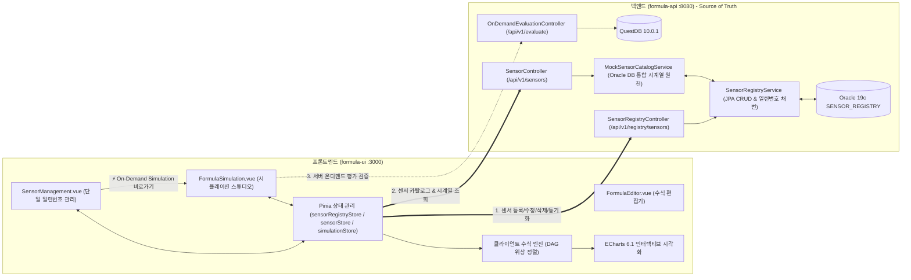
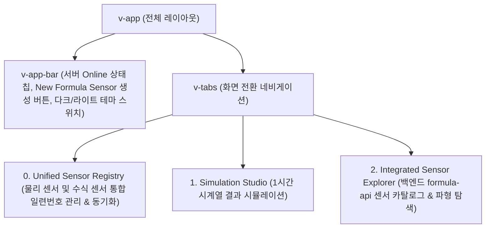

# 📊 Formula UI 사용자 및 아키텍처 가이드 (Frontend UI Guide)

본 문서는 **Formula Evaluator Service**의 온디멘드 요청(On-Demand Path) 및 센서 마스터 관리를 담당하는 프론트엔드 모듈인 **`formula-ui`**의 아키텍처 구성, 단일 센서 일련번호 체계 관리(`SensorManagement.vue`), 온디멘드 수식 시뮬레이션 메커니즘, 백엔드 서비스 연동 규격, 그리고 프론트엔드-백엔드 동시 실행 및 트러블슈팅 방법을 상세히 설명합니다.

---

## 1. 개요 및 기술 스택

`formula-ui`는 대규모 IoT 설비에서 유입되는 시계열 센서 데이터를 온디멘드로 조회하고, 사용자가 정의한 동적 수식(Formula)과 다중 센서 간 복합 연산 및 윈도우 집계 로직을 인터랙티브하게 검증 및 시뮬레이션할 수 있는 Single Page Application (SPA)입니다.

### 🏛️ 시스템 데이터 파이프라인 아키텍처

> [!IMPORTANT]
> **센서 데이터 및 일련번호 단일 진실 공급원 (Single Source of Truth)**:
> - 물리 센서와 수식 센서는 **Oracle 19c `SENSOR_REGISTRY` 테이블 및 `SENSOR_SERIAL_SEQ` (10001번 시작)**를 통해 전역 고유 일련번호(`serialNumber`)를 부여받습니다.
> - `formula-ui`의 `SensorManagement.vue`에서 추가, 수정, 삭제 및 IoT 장치 동기화가 수행되면, 백엔드(`formula-api`) 및 온디멘드 시뮬레이션 카탈로그(`sensorStore`)에 즉시 반영됩니다.



### 주요 기술 스택
| 구분 | 라이브러리 / 도구 | 버전 | 역할 |
| :--- | :--- | :--- | :--- |
| **Framework** | [Vue.js](https://vuejs.org/) | `3.5.43` | Composition API (`<script setup lang="ts">`) 기반 컴포넌트 개발 |
| **UI Library** | [Vuetify](https://vuetifyjs.com/) | `4.2.4` | Material Design 기반 엔지니어링 테마 대시보드 UI (`v-app`, `v-card`, `v-table`, `v-dialog`, `v-chip`) |
| **Icons** | [@mdi/font](https://materialdesignicons.com/) | `7.4.47` | Material Design Vector Icons (`mdi` 아이콘셋 바인딩) |
| **Bundler** | [Vite](https://vite.dev/) | `8.3.4` | 초고속 HMR 및 프로덕션 롤다운 빌드, 백엔드 API 리버스 프록시 |
| **State Management**| [Pinia](https://pinia.vuejs.org/) | `4.0.3` | 센서 레지스트리(`sensorRegistryStore`), 수식 정의(`formulaStore`), 반응형 통합 센서 카탈로그(`sensorStore` `computed`), 시뮬레이션 조정(`simulationStore`) |
| **Chart Visualizer**| [Apache ECharts](https://echarts.apache.org/) | `6.1.0` | 3,600초 시계열 인터랙티브 DataZoom 슬라이더 및 멀티 시리즈 렌더링 |
| **Testing** | [Vitest](https://vitest.dev/) | `5.0.3` | 센서 레지스트리 스토어, 수식 엔진, DAG 위상 정렬, API 클라이언트 단위/통합 테스트 (36개 테스트) |
| **Package Manager** | [pnpm](https://pnpm.io/) | `12.10.1` | 고속 및 디스크 효율적인 모노레포 패키지 관리 |

---

## 2. 모듈 디렉터리 구조

```
formula-ui/
├── src/
│   ├── components/
│   │   ├── SensorManagement.vue       # [신규] 통합 센서 일련번호 관리 (CRUD, IoT 장치 일괄 동기화)
│   │   ├── FormulaList.vue            # 작성 수식 목록 보기 및 관리
│   │   ├── FormulaEditor.vue          # 수식 작성, 수정 및 실시간 DAG 분석 모달
│   │   ├── FormulaSimulation.vue      # 1시간 시계열 결과 시뮬레이션 및 ECharts 차트
│   │   └── SensorDataExplorer.vue     # 백엔드 연동 센서 카탈로그 및 파형 탐색기
│   ├── services/
│   │   ├── sensorRegistryApi.ts       # [신규] Oracle 센서 레지스트리 REST API 클라이언트
│   │   ├── apiClient.ts               # formula-api REST 연동 클라이언트
│   │   ├── circularBuffer.ts          # Float64Array 기반 O(1) 슬라이딩 윈도우 링 버퍼
│   │   ├── formulaEngine.ts           # 토큰 파서, DAG 위상 정렬, 윈도우 함수 JIT 엔진
│   │   └── sensorDataGenerator.ts     # [오프라인/테스트 Fallback] 로컬 시계열 생성기
│   ├── stores/
│   │   ├── sensorRegistryStore.ts     # Oracle 센서 레지스트리 상태 관리 Pinia 스토어 (순수 CRUD/동기화)
│   │   ├── sensorStore.ts             # sensorRegistryStore + baseSensors 반응형(computed) 병합 센서 카탈로그 및 시계열 스토어
│   │   ├── formulaStore.ts            # 수식 정의 CRUD, ensureFormulaForRegistrySensor, localStorage 영속화
│   │   └── simulationStore.ts         # 백엔드 센서 스트림 기반 시뮬레이션 조정자 (prepareRegistrySensorSimulation 포함)
│   ├── test/
│   │   ├── apiClient.test.ts          # formula-api REST 클라이언트 및 URL 인코딩 단위 테스트
│   │   ├── sensorRegistryStore.test.ts # 레지스트리 Pinia 스토어 CRUD 단위 테스트
│   │   ├── sensorRegistryIntegration.test.ts # UI-온디멘드 시뮬레이션 통합 테스트
│   │   ├── formulaEngine.test.ts      # 수식 엔진 및 DAG 위상 정렬 Vitest 단위 테스트
│   │   ├── circularBuffer.test.ts     # CircularBuffer 단위 테스트
│   │   ├── formulaStore.test.ts       # Pinia 수식 스토어 CRUD Vitest 단위 테스트
│   │   └── benchmark.test.ts          # 86,400건 시계열 시뮬레이션 성능 벤치마크 테스트
│   ├── types/
│   │   ├── sensorRegistry.ts          # [신규] 센서 레지스트리 DTO 및 엔티티 타입 정의
│   │   ├── formula.ts                 # 수식 및 시뮬레이션 결과 타입 정의
│   │   └── sensor.ts                  # 센서 메타데이터 및 데이터포인트 타입 정의
│   ├── App.vue                        # 네비게이션 툴바, 탭 라우팅, 서버 온라인 상태 배지
│   └── main.ts                        # Vuetify 4 및 MDI Iconset 등록
```

---

## 3. UI 화면별 상세 기능 및 사용 방법



### 화면 0: 통합 센서 및 수식 일련번호 관리 (`SensorManagement.vue`)
* **단일 일련번호 체계 (`serialNumber: 10001+`) 및 수식 센서 통합**:
  - IoT 장치의 물리 센서(`PHYSICAL`)와 파생 수식 센서(`FORMULA`)가 별도 탭으로 분리되지 않고 **Unified Sensor Registry** 단일 화면과 단일 일련번호 체계로 통합 관리됩니다.
  - `sensorStore.sensors`와 `formulaStore.formulas` 모두 `sensorRegistryStore.sensors`를 반응형 `computed`로 파생하므로, 레지스트리에서 물리 센서나 수식 센서를 추가·수정·복제·삭제할 때마다 온디멘드 시뮬레이터와 탐색기에 즉시 반영됩니다.
  - 상단 KPI 통계 요약 카드(총 등록 센서, 물리 센서, 수식 센서, 연결된 IoT 장치 수)를 클릭하면 즉시 해당 센서 타입으로 필터링됩니다.
* **센서 및 수식 통합 등록/편집 모달**:
  - 물리 센서: 장치명(예: `DEVICE-001`), 장치 로컬 센서 인덱스(예: `0`), 센서명, 카테고리, 단위 입력.
  - 수식 센서: 선택적 수식 코드(`sensorCode`, 예: `TEMP_FAHRENHEIT`), 일련번호/서브수식 기반 계산식(예: `'P_10001 * 1.8 + 32'`), 원클릭 스니펫 삽입(물리 센서, 서브 수식, 윈도우 함수), 실시간 DAG 의존성 분석 및 Dry-Run 테스트 지원.
  - 다음 채번될 일련번호가 모달 상단에 칩으로 자동 프리뷰(`Next Serial: #10010`).
* **IoT 장치 일괄 동기화 (Sync Device)**:
  - `formula-emulator`의 IoT 장치(예: `DEVICE-001`) 센서 1,000개를 한 번에 등록하여 고유 일련번호를 순차 부여.
  - 기존 등록 센서 건너뛰기(`skipExisting: true`) 옵션 제공.
* **⚡ On-Demand Simulation 원클릭 연계 (`simulationStore.prepareRegistrySensorSimulation`)**:
  - 각 센서 행의 번개 모양 아이콘(`⚡`)을 클릭하면 `simulationStore.prepareRegistrySensorSimulation(sensor)`이 호출되어 `formulaStore.ensureFormulaForRegistrySensor(sensor)` 실행, 대상 센서 선택(`sensorStore.selectSensor`), 표현식 바인딩(`sensorStore.setExpression`)이 단일 진입점에서 처리된 후 `FormulaSimulation` 탭으로 즉시 전환됩니다.
* **🔄 Flink 룰 일괄 동기화 (Sync Rules to Flink)**:
  - 상단 툴바의 **"Sync Rules to Flink"** 버튼을 클릭하여 Oracle 19c `SENSOR_REGISTRY`의 모든 활성 수식 센서를 Kafka `rule-data` 토픽으로 일괄 발행.
  - Flink 클러스터 작업(Job) 재기동 없이 즉시 워커 메모리(`BroadcastState`)로 전파되어 실시간 수식 평가 활성화.
  - 원클릭 시 로딩 애니메이션 및 스낵바 완료 알림(`성공적으로 N개의 룰이 Flink로 동기화되었습니다`) 제공.
  - 오프라인 환경이나 테스트 시 로컬 Mock 스토리지 기반 Standalone 동기화로 무중단 폴백.

---

## 4. 백엔드 연동 및 검증 가이드

### UI 테스트 실행
```bash
cd formula-ui

# 36개 단위/통합 테스트 전체 실행 (Vitest)
pnpm test

# 프로덕션 번들 타입 체크 및 빌드
pnpm build
```

---

## 📚 관련 문서
* [시스템 전체 아키텍처 및 상세 엔지니어링 가이드 (ARCHITECTURE_GUIDE.md)](../ARCHITECTURE_GUIDE.md)
* [도메인 용어 사전 (GLOSSARY.md)](../GLOSSARY.md)
* [스트리밍 평가 룰 전파 아키텍처 가이드 (STREAMING_EVALUATOR_GUIDE.md)](STREAMING_EVALUATOR_GUIDE.md)
* [IoT 센서 에뮬레이션 및 엔드투엔드 파이프라인 가이드 (SENSOR_SIMULATION_AND_PIPELINE_GUIDE.md)](SENSOR_SIMULATION_AND_PIPELINE_GUIDE.md)
