# 📡 IoT 센서 시뮬레이션 및 엔드투엔드 시계열 파이프라인 가이드

본 문서는 **Formula Evaluator Service**의 IoT 센서 에뮬레이션 툴(`formula-emulator`)의 기술적인 원리와 실행 방법, 그리고 **센서 변동 발생부터 카프카 전송, Flink 실시간 수식 평가, QuestDB 최종 적재까지의 엔드투엔드 워크플로우**를 다이어그램과 함께 상세히 정리한 엔지니어링 기술 가이드입니다.

---

## 1. 🔄 엔드투엔드 워크플로우 다이어그램 (Workflow Diagram)

센서에서 측정값 변동이 일어나는 순간부터 Flink 분산 룰 엔진에서 계산되어 TSDB(QuestDB)에 도달하기까지의 전체 처리 흐름입니다.

```mermaid
flowchart TD
    %% 1단계: 에뮬레이터 센서 변동
    subgraph Step1["1단계: IoT 센서 에뮬레이션 (formula-emulator)"]
        direction TB
        Sensors["1,000개 EmulatedSensor 풀<br/>(독립 타이머: 1s ~ 10s 주기)"]
        StateCheck{"상태 전이 판정<br/>(99% normal, 1% down)"}
        ValueDrift["정규분포 기반 랜덤 워크 측정값 갱신<br/>(소수점 3자리 반올림)"]
        TickScheduler["1초 주기 무지연 스케줄러<br/>(scheduleAtFixedRate & Jitter 측정)"]
        BatchCollector["1초 동안 변동된 센서 목록 취합<br/>(List&lt;SensorItem&gt; 집계)"]

        Sensors --> StateCheck
        StateCheck --> ValueDrift
        ValueDrift --> BatchCollector
        TickScheduler --> BatchCollector
    end

    %% 2단계: 카프카 전송
    subgraph Step2["2단계: 카프카 무지연 비동기 전송"]
        direction TB
        KafkaHeaders["Kafka Record Headers<br/>- deviceId: 'DEVICE-001'<br/>- timestamp: 1729152000000"]
        KafkaBody["Kafka Record Value (Body)<br/>JSON Array: [ {sensorIndex, value, status}, ... ]"]
        AsyncSend["KafkaProducer.send() (Non-blocking Async)<br/>- linger.ms = 0 (버퍼 대기 제거)<br/>- acks = 1 (초고속 승인)"]

        BatchCollector --> KafkaHeaders & KafkaBody
        KafkaHeaders & KafkaBody --> AsyncSend
    end

    %% 3단계: 메시지 브로커
    subgraph Step3["3단계: Apache Kafka 3.9"]
        SensorTopic[("Topic: sensor-data<br/>(Partitioned Stream)")]
        AsyncSend -->|즉각 스트리밍 전송| SensorTopic
    end

    %% 4단계: Flink 역직렬화 & 평탄화
    subgraph Step4["4단계: Flink 역직렬화 및 소스 평탄화 (formula-flink)"]
        direction TB
        Deserializer["DeviceSensorRecordDeserializer<br/>(KafkaRecordDeserializationSchema)"]
        ExtractHeader["헤더 추출: deviceId, 전송 timestamp"]
        FlatMapArray["바디 JSON 배열 FlatMap<br/>(Collector.collect() N회 방출)"]
        EmitSensorData["DataStream&lt;SensorData&gt; 생성<br/>- sensorId: 'sensor_015'<br/>- value, timestamp, state"]

        SensorTopic --> Deserializer
        Deserializer --> ExtractHeader & FlatMapArray
        ExtractHeader & FlatMapArray --> EmitSensorData
    end

    %% 5단계: 분산 스트림 처리 & 수식 평가
    subgraph Step5["5단계: 동적 룰 평가 및 상태 계산"]
        direction TB
        KeyByStream["keyBy(SensorData::getSensorId)<br/>(센서 ID별 워커 노드 수평 분산)"]
        BroadcastRules["Rule Broadcast Stream<br/>(관리자 정의 동적 룰 복제 전파)"]
        ProcessFunc["RuleBroadcastProcessFunction<br/>(KeyedBroadcastProcessFunction)"]
        RocksDBState["RocksDB State Backend<br/>(30분 슬라이딩 윈도우 + TTL 관리)"]
        AviatorJIT["AviatorScript 5.9.0 JIT 컴파일러<br/>(window_avg, window_max 연산)"]
        OutCollect["원본 SensorData + 파생 SensorData 방출<br/>(target: sensor_015, sensor_015_derived)"]

        EmitSensorData --> KeyByStream
        KeyByStream & BroadcastRules --> ProcessFunc
        ProcessFunc <--> RocksDBState
        ProcessFunc --> AviatorJIT
        AviatorJIT --> OutCollect
    end

    %% 6단계: QuestDB 저장
    subgraph Step6["6단계: 시계열 데이터 저장소 적재"]
        direction TB
        QuestSink["QuestDbIlpSink<br/>(Influx Line Protocol 클라이언트)"]
        ILPBuffer["Zero-GC TCP 소켓 버퍼링<br/>(auto_flush_rows=100,000)"]
        QuestDB[("QuestDB 10.0.1<br/>sensor_data 테이블<br/>(일별 파티션, Columnar 스토리지)")]

        OutCollect --> QuestSink
        QuestSink --> ILPBuffer
        ILPBuffer -->|ILP TCP 통신| QuestDB
    end

    %% 연결 라인 스타일
    classDef stepClass fill:#f8f9fa,stroke:#343a40,stroke-width:2px;
    class Step1,Step2,Step3,Step4,Step5,Step6 stepClass;
```



---

## 2. 🧩 단계별 기술 메커니즘 및 상세 분석

### 단계 1: IoT 센서 에뮬레이터 (`formula-emulator`)
* **센서 풀(Sensor Pool) 관리**:
  - 기본 1,000개의 [`EmulatedSensor`](file:///C:/Users/imoil/repo/formula-evaluator-service/formula-emulator/src/main/java/com/imoil/formula/emulator/model/EmulatedSensor.java) 인스턴스를 메모리에 유지합니다.
  - 각 센서는 인덱스(0 ~ 999)에 따라 고유한 기준값(`baseMean`, 20.0 ~ 170.0)과 표준편차(`stdDev`)를 가지며, 온도·압력·전압 등 다양한 물리량 특성을 모의합니다.
* **1초 ~ 10초 무작위 변동 주기**:
  - 센서마다 다음 변동 시점(`nextChangeTimeMs`)을 `현재시각 + Random(1~10초)`로 개별 스케줄링합니다.
  - 변동 시점이 도래하면 정규분포 랜덤 워크를 통해 값을 갱신하고, 설정된 확률(기본 1%)에 따라 `normal` $\leftrightarrow$ `down` 상태를 전이합니다.
* **1초 무지연 스케줄러 (`ScheduledExecutorService`)**:
  - `scheduleAtFixedRate`를 채택하여 앞선 작업의 소요 시간과 무관하게 정확히 1,000ms 간격으로 고정 실행됩니다.
  - 이전 틱 대비 지연 시간(Jitter)을 마이크로초 단위로 측정하여 100ms 초과 시 경고를 발생시킵니다.
  - 1,000개 센서의 변동 판정 및 집계는 메모리 상에서 불과 1~2ms 이내에 완료되므로 메인 루프에 지연이 누적되지 않습니다.

---

### 단계 2: 카프카 무지연 비동기 전송 (`SensorKafkaProducer`)
* **Kafka Record 구조 규격**:
  - **Record Headers**:
    - `deviceId`: 장치 고유명 (예: `DEVICE-001`, UTF-8 byte)
    - `timestamp`: 전송 기준 에포크 밀리초 (예: `1729152000000`, UTF-8 byte)
  - **Record Value (Body)**:
    - 1초 동안 변동이 일어난 센서들만 선별된 JSON 배열:
      ```json
      [
        {
          "sensorIndex": 3,
          "value": 45.215,
          "status": "normal"
        },
        {
          "sensorIndex": 42,
          "value": 0.0,
          "status": "down"
        }
      ]
      ```
* **논블로킹 비동기 전송 (Non-blocking Async Send)**:
  - Kafka 전송 시 `.send(record, callback)`으로 호출하여 네트워크 왕복 대기(RTT) 없이 즉시 다음 루프로 복귀합니다.
  - 프로듀서 옵션: `linger.ms = 0` (대기 버퍼링 없이 즉시 패킷 송출), `acks = 1`, `max.block.ms = 1000`.

---

### 단계 3 & 4: Flink 레코드 역직렬화 및 평탄화 (`formula-flink`)
* **[`DeviceSensorRecordDeserializer`](file:///C:/Users/imoil/repo/formula-evaluator-service/formula-flink/src/main/java/com/imoil/formula/flink/DeviceSensorRecordDeserializer.java)**:
  - Flink 1.19 표준 `KafkaRecordDeserializationSchema<SensorData>`를 구현합니다.
  - `ConsumerRecord`로부터 Kafka Headers의 `deviceId`와 `timestamp`를 파싱합니다.
  - Value 바디의 JSON 배열을 파싱하여, 변동된 센서 수($N$개)만큼 Flink의 `Collector.collect(SensorData)`를 반복 호출(FlatMap)합니다.
  - 매핑 규칙:
    - `sensorId`: `sensor_{sensorIndex}` (예: 5번 센서 $\rightarrow$ `sensor_005`)
    - `timestamp`: 카프카 헤더의 전송 시각
    - `value`: 센서 변동 측정값
    - `state`: `status == "down" ? 1 : 0`

---

### 단계 5: 동적 룰 평가 및 슬라이딩 윈도우 계산
* **KeyBy 수평 분산**: `keyBy(SensorData::getSensorId)`로 센서별 이벤트를 Flink 워커에 해시 분산합니다.
* **Broadcast State 동적 룰 전파**:
  - `rule-data` 토픽을 통해 발행된 관리자 수식을 모든 Flink 작업 노드로 복제(Broadcast)합니다.
  - 작업 재시작 없이 수식이 메모리에 즉시 반영됩니다.
* **보안 샌드박스 및 AviatorScript JIT 컴파일**:
  - `ExpressionValidator`가 시스템 명령어, 리플렉션, 무한 루프 시도를 원천 차단합니다.
  - `window_avg(10)` 또는 `value > 50`과 같은 수식을 바이트코드로 컴파일하여 나노초 단위로 평가합니다.
* **RocksDB StateBackend & TTL**:
  - 30분 슬라이딩 윈도우 데이터를 RocksDB에 저장하며, 만료된 상태 데이터는 RocksDB TTL에 의해 자동 청소되어 OOM(Out of Memory)을 방지합니다.

---

### 단계 6: QuestDB ILP 고속 적재 (`QuestDbIlpSink`)
* **Influx Line Protocol(ILP) TCP 소켓 적재**:
  - QuestDB 전용 초경량 Zero-GC 클라이언트(`questdb-client:1.3.9`)를 사용합니다.
  - 원본 센서 데이터와 Flink 파생 데이터(`_derived`)를 일괄 전송합니다.
  - `auto_flush_rows = 100000`, `auto_flush_interval = 1000` 설정을 통해 초당 수십만 건의 데이터를 디스크 IO 오버헤드 없이 적재합니다.

---

## 3. ⚙️ 에뮬레이터 CLI 파라미터 레퍼런스

에뮬레이터는 다양한 테스트 시나리오를 지원하기 위해 다음과 같은 CLI 인자를 제공합니다.

| CLI 파라미터 | 기본값 | 설명 |
| :--- | :---: | :--- |
| `--device-id` | `DEVICE-001` | 카프카 헤더에 포함될 디바이스 고유명 |
| `--sensor-count` | `1000` | 에뮬레이션할 전체 센서 개수 (예: 500, 1000, 5000) |
| `--min-interval` | `1` | 센서별 최소 변동 주기 (초) |
| `--max-interval` | `10` | 센서별 최대 변동 주기 (초) |
| `--emit-interval-ms` | `1000` | 카프카 배치 전송 주기 (밀리초, 기본 1초) |
| `--kafka-servers` | `localhost:9092` | Kafka 브로커 주소 |
| `--kafka-topic` | `sensor-data` | 전송할 카프카 센서 토픽명 |
| `--down-probability` | `0.01` | 센서 틱당 'down' 장애 상태 전이 확률 (0.01 = 1%) |

---

## 4. 🛠️ 로컬 핸즈온(Hands-on) 실습 가이드 (End-to-End Walkthrough)

개발자가 로컬 머신에서 인프라 구동부터 룰 주입, Flink 실시간 계산, 에뮬레이터 가동, QuestDB 결과 확인까지 전체 흐름을 단계별로 직접 따라할 수 있는 실습 가이드입니다.

```
[로컬 실습 환경 아키텍처]
┌────────────────────────────────────────────────────────┐
│ 터미널 1: 인프라 (Docker/Podman Compose)               │
│ - Kafka (9092) & QuestDB (9000, 8812)                  │
├────────────────────────────────────────────────────────┤
│ 터미널 2: Flink 스트리밍 잡 (formula-flink)            │
│ - Kafka 소스 역직렬화 → Broadcast 룰 엔진 → QuestDB   │
├────────────────────────────────────────────────────────┤
│ 터미널 3: IoT 센서 에뮬레이터 (formula-emulator)       │
│ - 1,000개 센서 모의 & 매 1초 무지연 Kafka 비동기 발송  │
├────────────────────────────────────────────────────────┤
│ 터미널 4 / 브라우저: 검증 및 룰 주입                   │
│ - Kafka 토픽 확인, 룰 JSON 주입, QuestDB Web Console   │
└────────────────────────────────────────────────────────┘
```

---

### Step 1: 인프라 컨테이너 기동 및 헬스체크 (터미널 1)

프로젝트 루트 경로에서 제공되는 compose 파일을 사용하여 Kafka와 QuestDB를 기동합니다.

```bash
# Docker Compose 사용 시
docker compose -f podman-compose.yml up -d

# Podman 사용 시
podman-compose up -d
```

#### 헬스체크 확인:
```bash
# 컨테이너 상태 점검
docker ps

# QuestDB 웹 콘솔 포트(9000) 오픈 확인
curl -I http://localhost:9000
```
* **QuestDB Web Console**: `http://localhost:9000`
* **QuestDB PGWire 포트**: `localhost:8812`
* **Kafka 브로커 포트**: `localhost:9092`

---

### Step 2: Kafka 토픽 생성 및 초기 동적 룰(Rule) 주입 (터미널 4)

Flink 잡이 기동될 때 센서 데이터를 즉시 평가할 수 있도록 동적 룰 메타데이터를 `rule-data` 토픽에 주입합니다.

#### 1) Kafka 토픽 사전 생성 (필요 시)
```bash
# Kafka 컨테이너 내부 CLI를 활용한 토픽 생성
docker exec -it formula-kafka kafka-topics --bootstrap-server localhost:9092 --create --if-not-exists --topic sensor-data --partitions 3 --replication-factor 1
docker exec -it formula-kafka kafka-topics --bootstrap-server localhost:9092 --create --if-not-exists --topic rule-data --partitions 1 --replication-factor 1
```

#### 2) 관리자 동적 룰(Dynamic Rule) 발행
아래와 같이 2개의 룰을 JSON 형식으로 `rule-data` 토픽에 전송합니다:
* **Rule 1 (`sensor_000`)**: 화씨 변환 수식 (`value * 1.8 + 32.0`)
* **Rule 2 (`sensor_001`)**: 10초 슬라이딩 이동평균 집계 수식 (`window_avg(10)`)

```bash
# Docker CLI를 통해 rule-data 토픽에 룰 JSON 직접 주입
docker exec -i formula-kafka kafka-console-producer --bootstrap-server localhost:9092 --topic rule-data << 'EOF'
{"ruleId":"rule_fahrenheit","targetSensorId":"sensor_000","expression":"value * 1.8 + 32.0","usesWindow":false}
{"ruleId":"rule_moving_avg","targetSensorId":"sensor_001","expression":"window_avg(10)","usesWindow":true}
EOF
```

> **Windows PowerShell 사용 시:**
> ```powershell
> '{"ruleId":"rule_fahrenheit","targetSensorId":"sensor_000","expression":"value * 1.8 + 32.0","usesWindow":false}' | docker exec -i formula-kafka kafka-console-producer --bootstrap-server localhost:9092 --topic rule-data
> '{"ruleId":"rule_moving_avg","targetSensorId":"sensor_001","expression":"window_avg(10)","usesWindow":true}' | docker exec -i formula-kafka kafka-console-producer --bootstrap-server localhost:9092 --topic rule-data
> ```

---

### Step 3: Flink 스트리밍 잡 기동 (터미널 2)

Flink 스트리밍 평가 잡을 로컬에서 빌드하고 실행합니다.

```bash
# 1. formula-flink 모듈 빌드
gradle :formula-flink:jar

# 2. Flink StreamingEvaluatorJob 실행 (로컬 Java 프로세스로 기동)
# Windows PowerShell:
java -cp "formula-flink/build/libs/formula-flink-0.0.1-SNAPSHOT.jar;formula-flink/build/resources/main;formula-flink/build/classes/java/main" com.imoil.formula.flink.StreamingEvaluatorJob --kafka-bootstrap-servers localhost:9092 --kafka-topic-sensor sensor-data --kafka-topic-rule rule-data --questdb-url "http::addr=localhost:9000;auto_flush_interval=1000;auto_flush_rows=100000;"

# 또는 Flink 클러스터 CLI 제출 시:
# flink run -c com.imoil.formula.flink.StreamingEvaluatorJob formula-flink/build/libs/formula-flink-0.0.1-SNAPSHOT.jar --kafka-bootstrap-servers localhost:9092
```

* 기동 후 로그에 `RuleBroadcastProcessFunction` 초기화 및 Kafka Source 연결 확인:
  ```text
  INFO  c.i.f.f.StreamingEvaluatorJob - Job started: Formula Evaluator Streaming Job
  ```

---

### Step 4: IoT 센서 에뮬레이터 기동 (터미널 3)

1,000대 센서를 모의하고 매 1초마다 변동된 센서들을 Kafka로 비동기 송출하는 에뮬레이터를 기동합니다.

```powershell
# 기본 설정(1,000대 센서, 1초 주기 발송)으로 기동
gradle :formula-emulator:run --args="--device-id=DEVICE-FACTORY-01 --sensor-count=1000 --emit-interval-ms=1000"
```

#### 에뮬레이터 콘솔 출력 화면:
```text
==================================================
  Starting IoT Sensor Device Emulator
  Device ID           : DEVICE-FACTORY-01
  Sensor Count        : 1000
  Change Interval     : 1s ~ 10s
  Emit Interval       : 1000ms
  Kafka Topic         : sensor-data
  Kafka Brokers       : localhost:9092
  Down Probability    : 0.01
==================================================
2026-10-17 15:10:01.120 [main] INFO  c.i.f.e.e.SensorDeviceEmulator - Initialized 1000 emulated sensors for device: DEVICE-FACTORY-01
2026-10-17 15:10:01.125 [main] INFO  c.i.f.e.e.SensorDeviceEmulator - SensorDeviceEmulator started with interval 1000ms for device DEVICE-FACTORY-01
2026-10-17 15:10:05.127 [sensor-emulator-ticker] INFO  c.i.f.e.e.SensorDeviceEmulator - Tick #5: 118/1000 sensors changed, processed in 1240 µs (device: DEVICE-FACTORY-01)
2026-10-17 15:10:10.128 [sensor-emulator-ticker] INFO  c.i.f.e.e.SensorDeviceEmulator - Tick #10: 125/1000 sensors changed, processed in 1180 µs (device: DEVICE-FACTORY-01)
```
> **성능 확인**: 1,000개 센서의 변동 검사와 전송 틱 처리가 **약 1.2ms(`1240 µs`)**만에 완료되며, 1초 주기의 시간 지연(Drift)이 발생하지 않습니다.

---

### Step 5: Kafka 메시지 실시간 수신 검증 (터미널 4)

카프카 콘솔 컨슈머를 사용하여 헤더(장치명, 전송시간)와 바디(센서 JSON 배열)가 실제로 1초마다 들어오는지 확인합니다.

```bash
docker exec -it formula-kafka kafka-console-consumer \
  --bootstrap-server localhost:9092 \
  --topic sensor-data \
  --property print.headers=true \
  --property print.timestamp=true \
  --max-messages 3
```

#### 터미널 출력 결과 예시:
```text
CreateTime:1792217105000	deviceId:DEVICE-FACTORY-01,timestamp:1792217105000	[{"sensorIndex":0,"value":25.4,"status":"normal"},{"sensorIndex":1,"value":48.2,"status":"normal"},{"sensorIndex":88,"value":0.0,"status":"down"}]
CreateTime:1792217106000	deviceId:DEVICE-FACTORY-01,timestamp:1792217106000	[{"sensorIndex":15,"value":104.2,"status":"normal"},{"sensorIndex":34,"value":68.9,"status":"normal"}]
CreateTime:1792217107000	deviceId:DEVICE-FACTORY-01,timestamp:1792217107000	[{"sensorIndex":0,"value":26.1,"status":"normal"},{"sensorIndex":77,"value":12.3,"status":"normal"}]
```

---

### Step 6: QuestDB 콘솔에서 실시간 계산 결과 검증 (브라우저)

웹 브라우저를 열고 `http://localhost:9000`에 접속하여 QuestDB 웹 콘솔에 들어갑니다.

#### 1) 전체 최신 적재 데이터 조회 (원본 및 파생 데이터)
```sql
SELECT timestamp, sensor_id, value, state, has_inaccurate_data
FROM sensor_data
ORDER BY timestamp DESC
LIMIT 20;
```

#### 2) `sensor_000`에 대한 동적 룰(`value * 1.8 + 32.0`) 평가 검증
```sql
-- 원본 센서값과 파생(_derived) 계산값 비교
SELECT timestamp, sensor_id, value
FROM sensor_data
WHERE sensor_id IN ('sensor_000', 'sensor_000_derived')
ORDER BY timestamp DESC
LIMIT 10;
```
* **결과 확인 예시**:
  | timestamp | sensor_id | value |
  | :--- | :--- | :--- |
  | 2026-10-17T06:10:07.000000Z | sensor_000_derived | **78.98** |
  | 2026-10-17T06:10:07.000000Z | sensor_000 | **26.10** |
  *(26.10 * 1.8 + 32.0 = 78.98로 Flink에서 실시간 정확히 계산되어 저장됨)*

#### 3) `sensor_001`에 대한 슬라이딩 윈도우 이동평균(`window_avg(10)`) 검증
```sql
SELECT timestamp, sensor_id, value, has_inaccurate_data
FROM sensor_data
WHERE sensor_id = 'sensor_001_derived'
ORDER BY timestamp DESC
LIMIT 5;
```

#### 4) 1초 단위 실시간 다운샘플링 집계 (QuestDB TSDB 특화)
```sql
SELECT timestamp, sensor_id, avg(value) as avg_val, max(value) as max_val, count()
FROM sensor_data
SAMPLE BY 1s;
```

---

### Step 7: 센서 장애 발생(Down) 및 복구 시뮬레이션 실습

센서 이상 발생 시 시스템의 거동을 확인하기 위해, 에뮬레이터의 `down-probability`를 15%로 높여 실행해 봅니다.

```powershell
# 터미널 3에서 기존 에뮬레이터 중단(Ctrl+C) 후 높은 장애 확률로 재기동
gradle :formula-emulator:run --args="--device-id=DEVICE-FAULTY --sensor-count=1000 --down-probability=0.15"
```

#### QuestDB에서 다운 센서 격리 상태 확인:
```sql
-- state가 1(down)인 센서 이벤트 확인 (value가 0.0으로 안전 격리됨)
SELECT timestamp, sensor_id, value, state
FROM sensor_data
WHERE state = 1
ORDER BY timestamp DESC
LIMIT 10;
```

---

### Step 8: 실습 종료 및 환경 정리 (Tear-down)

모든 실습이 완료되면 프로세스와 도커 컨테이너를 정상 종료합니다.

```bash
# 1. 터미널 2, 3에서 실행 중인 프로세스 종료: Ctrl + C

# 2. 인프라 컨테이너 정리 (터미널 1)
docker compose -f podman-compose.yml down

# Podman 사용 시
podman-compose down
```

---

## 5. 📊 성능 최적화 및 모니터링 체크리스트

1. **지연 방지 모니터링 (Jitter Metrics)**:
   - 에뮬레이터 콘솔 로그에서 5초마다 출력되는 `processed in X µs` 및 지연 경고(`Tick jitter detected: X ms behind schedule`)를 확인합니다. 1,000개 기준 통상 수백 마이크로초 수준으로 처리됩니다.
2. **카프카 프로듀서 메모리 관리**:
   - `linger.ms = 0` 및 비동기 콜백 처리를 통해 내부 버퍼 누수 없이 지속적인 1초 송출이 유지됩니다.
3. **Flink RocksDB 백엔드 TTL**:
   - `StateTtlConfig`(30분) 설정으로 인해 메모리가 무한정 증가하지 않으며, 오래된 센서 슬라이딩 이력은 백그라운드 컴팩션 시 자동으로 정리됩니다.
