# 📡 IoT 센서 시뮬레이션 및 엔드투엔드 시계열 파이프라인 가이드

본 문서는 **Formula Evaluator Service**의 IoT 센서 에뮬레이션 툴(`formula-emulator`)의 기술적인 원리와 실행 방법, 그리고 **센서 변동 발생부터 카프카 전송, 단일 일련번호 매핑, Flink 실시간 수식 평가, QuestDB 최종 적재까지의 엔드투엔드 워크플로우**를 다이어그램과 함께 상세히 정리한 엔지니어링 기술 가이드입니다.

---

## 1. 🔄 엔드투엔드 워크플로우 다이어그램 (Workflow Diagram)

센서에서 측정값 변동이 일어나는 순간부터 Flink 분산 룰 엔진에서 계산되어 TSDB(QuestDB)에 도달하기까지의 전체 처리 흐름입니다.

```mermaid
flowchart TD
    %% 1단계: 에뮬레이터 센서 변동
    subgraph Step1["1단계: IoT 센서 에뮬레이션 (formula-emulator)"]
        direction TB
        Sensors["1,000개 EmulatedSensor 풀<br/>(독립 타이머: 1s ~ 10s 주기)"]
        StateCheck{"상태 전이 판정<br/>(99% normal, 1% down)"}
        ValueDrift["정규분포 기반 랜덤 워크 측정값 갱신<br/>(소수점 3자리 반올림)"]
        TickScheduler["1초 주기 무지연 스케줄러<br/>(scheduleAtFixedRate & Jitter 측정)"]
        BatchCollector["1초 동안 변동된 센서 목록 취합<br/>(List&lt;SensorItem&gt; 집계)"]

        Sensors --> StateCheck
        StateCheck --> ValueDrift
        ValueDrift --> BatchCollector
        TickScheduler --> BatchCollector
    end

    %% 2단계: 카프카 전송
    subgraph Step2["2단계: 카프카 무지연 비동기 전송"]
        direction TB
        KafkaHeaders["Kafka Record Headers<br/>- deviceId: 'DEVICE-001'<br/>- timestamp: 1729152000000"]
        KafkaBody["Kafka Record Value (Body)<br/>JSON Array: [ {sensorIndex, value, status}, ... ]"]
        AsyncSend["KafkaProducer.send() (Non-blocking Async)<br/>- linger.ms = 0 (버퍼 대기 제거)<br/>- acks = 1 (초고속 승인)"]

        BatchCollector --> KafkaHeaders & KafkaBody
        KafkaHeaders & KafkaBody --> AsyncSend
    end

    %% 3단계: 메시지 브로커
    subgraph Step3["3단계: Apache Kafka 3.9"]
        SensorTopic[("Topic: sensor-data<br/>(Partitioned Stream)")]
        AsyncSend -->|즉각 스트리밍 전송| SensorTopic
    end

    %% 4단계: Flink 역직렬화 & 단일 일련번호 매핑
    subgraph Step4["4단계: Flink 역직렬화 및 단일 일련번호 매핑 (formula-flink)"]
        direction TB
        Deserializer["DeviceSensorRecordDeserializer<br/>(KafkaRecordDeserializationSchema)"]
        ExtractHeader["헤더 추출: deviceId, 전송 timestamp"]
        SerialResolver["SensorSerialResolver (전역 리졸버)<br/>(deviceId, sensorIndex) ➔ serialNumber (10001+)"]
        FlatMapArray["바디 JSON 배열 FlatMap<br/>(Collector.collect() N회 방출)"]
        EmitSensorData["DataStream&lt;SensorData&gt; 생성<br/>- sensorId: '10001' (단일 일련번호)<br/>- value, timestamp, state"]

        SensorTopic --> Deserializer
        Deserializer --> ExtractHeader & FlatMapArray
        ExtractHeader & FlatMapArray --> SerialResolver --> EmitSensorData
    end

    %% 5단계: 분산 스트림 처리 & 수식 평가
    subgraph Step5["5단계: 동적 룰 평가 및 상태 계산"]
        direction TB
        KeyByStream["keyBy(SensorData::getSensorId)<br/>(단일 일련번호 해시 분산, 장치 간 충돌 원천 차단)"]
        BroadcastRules["Rule Broadcast Stream<br/>(targetSensorId: '10001' or 'SN_10001', derivedSensorId: '10201')"]
        ProcessFunc["RuleBroadcastProcessFunction<br/>(KeyedBroadcastProcessFunction)"]
        RocksDBState["RocksDB State Backend<br/>(30분 슬라이딩 윈도우 + TTL 관리)"]
        AviatorJIT["AviatorScript 5.9.0 JIT 컴파일러<br/>(window_avg, window_max 연산)"]
        OutCollect["원본 SensorData(10001) + 파생 수식 SensorData(10201) 방출"]

        EmitSensorData --> KeyByStream
        KeyByStream & BroadcastRules --> ProcessFunc
        ProcessFunc <--> RocksDBState
        ProcessFunc --> AviatorJIT
        AviatorJIT --> OutCollect
    end

    %% 6단계: QuestDB 저장
    subgraph Step6["6단계: 시계열 데이터 저장소 적재"]
        direction TB
        QuestSink["QuestDbIlpSink<br/>(Influx Line Protocol 클라이언트)"]
        ILPBuffer["Zero-GC TCP 소켓 버퍼링<br/>(auto_flush_rows=100,000)"]
        QuestDB[("QuestDB 10.0.1<br/>sensor_data 테이블<br/>(일별 파티션, Columnar 스토리지)")]

        OutCollect --> QuestSink
        QuestSink --> ILPBuffer
        ILPBuffer -->|ILP TCP 통신| QuestDB
    end

    %% 연결 라인 스타일
    classDef stepClass fill:#f8f9fa,stroke:#343a40,stroke-width:2px;
    class Step1,Step2,Step3,Step4,Step5,Step6 stepClass;
```



---

## 2. 🧩 단계별 기술 메커니즘 및 상세 분석

### 단계 1: IoT 센서 에뮬레이터 (`formula-emulator`)
* **센서 풀(Sensor Pool) 관리**:
  - 기본 1,000개의 [`EmulatedSensor`](file:///C:/Users/imoil/repo/formula-evaluator-service/formula-emulator/src/main/java/com/imoil/formula/emulator/model/EmulatedSensor.java) 인스턴스를 메모리에 유지합니다.
  - 각 센서는 인덱스(0 ~ 999)에 따라 고유한 기준값(`baseMean`, 20.0 ~ 170.0)과 표준편차(`stdDev`)를 가지며, 온도·압력·전압 등 다양한 물리량 특성을 모의합니다.
* **1초 ~ 10초 무작위 변동 주기**:
  - 센서마다 다음 변동 시점(`nextChangeTimeMs`)을 `현재시각 + Random(1~10초)`로 개별 스케줄링합니다.
  - 변동 시점이 도래하면 정규분포 랜덤 워크를 통해 값을 갱신하고, 설정된 확률(기본 1%)에 따라 `normal` $\leftrightarrow$ `down` 상태를 전이합니다.
* **1초 무지연 스케줄러 (`ScheduledExecutorService`)**:
  - `scheduleAtFixedRate`를 채택하여 앞선 작업의 소요 시간과 무관하게 정확히 1,000ms 간격으로 고정 실행됩니다.
  - 이전 틱 대비 지연 시간(Jitter)을 마이크로초 단위로 측정하여 100ms 초과 시 경고를 발생시킵니다.

---

### 단계 2: 카프카 무지연 비동기 전송 (`SensorKafkaProducer`)
* **Kafka Record 구조 규격**:
  - **Record Headers**:
    - `deviceId`: 장치 고유명 (예: `DEVICE-001`, UTF-8 byte)
    - `timestamp`: 전송 기준 에포크 밀리초 (예: `1729152000000`, UTF-8 byte)
  - **Record Value (Body)**:
    - 1초 동안 변동이 일어난 센서들만 선별된 JSON 배열:
      ```json
      [
        {
          "sensorIndex": 3,
          "value": 45.215,
          "status": "normal"
        },
        {
          "sensorIndex": 42,
          "value": 0.0,
          "status": "down"
        }
      ]
      ```
* **논블로킹 비동기 전송 (Non-blocking Async Send)**:
  - Kafka 전송 시 `.send(record, callback)`으로 호출하여 네트워크 왕복 대기(RTT) 없이 즉시 다음 루프로 복귀합니다.
  - 프로듀서 옵션: `linger.ms = 0` (대기 버퍼링 없이 즉시 패킷 송출), `acks = 1`, `max.block.ms = 1000`.

---

### 단계 3 & 4: Flink 레코드 역직렬화 및 단일 일련번호 매핑 (`formula-flink`)
* **[`DeviceSensorRecordDeserializer`](file:///C:/Users/imoil/repo/formula-evaluator-service/formula-flink/src/main/java/com/imoil/formula/flink/DeviceSensorRecordDeserializer.java)**:
  - Flink 1.19 표준 `KafkaRecordDeserializationSchema<SensorData>`를 구현합니다.
  - `ConsumerRecord`로부터 Kafka Headers의 `deviceId`와 `timestamp`를 파싱합니다.
  - Value 바디의 JSON 배열을 순회하며 [`SensorSerialResolver`](file:///C:/Users/imoil/repo/formula-evaluator-service/formula-core/src/main/java/com/imoil/formula/domain/SensorSerialResolver.java)를 호출합니다:
    ```java
    long serialNumber = resolver.resolveSerialNumber(deviceId, item.getSensorIndex());
    String sensorId = String.valueOf(serialNumber); // 예: "10001", "10101"
    ```
  - **충돌 방지 원리**: `DEVICE-001`의 0번 센서(`10001`)와 `DEVICE-002`의 0번 센서(`10101`)가 서로 다른 고유 일련번호로 매핑되므로, 다운스트림 `keyBy` 파티셔닝에서 상호 간섭이 발생하지 않습니다.
  - 변동된 센서 수($N$개)만큼 `Collector.collect(SensorData)`를 반복 호출(FlatMap)합니다.

---

### 단계 5: 동적 룰 평가 및 슬라이딩 윈도우 계산
* **KeyBy 수평 분산**: `keyBy(SensorData::getSensorId)`로 센서별 이벤트를 Flink 워커에 해시 분산합니다.
* **Broadcast State 동적 룰 전파**:
  - `rule-data` 토픽을 통해 발행된 관리자 수식을 모든 Flink 작업 노드로 복제(Broadcast)합니다.
  - 단일 일련번호(`"10001"`)와 접두사 형태(`"SN_10001"`) 모두 양방향으로 매칭되어 수식이 즉각 평가됩니다.
  - 룰에 `derivedSensorId`가 지정되어 있는 경우(예: `"10201"`), 수식 연산 결과로 방출되는 파생 센서의 `sensorId`가 `"10201"`로 부여되어 TSDB에 적재됩니다.
* **보안 샌드박스 및 AviatorScript JIT 컴파일**:
  - `ExpressionValidator`가 시스템 명령어, 리플렉션, 무한 루프 시도를 원천 차단합니다.
  - `window_avg(10)` 또는 `value > 50`과 같은 수식을 바이트코드로 컴파일하여 나노초 단위로 평가합니다.
* **RocksDB StateBackend & TTL**:
  - 30분 슬라이딩 윈도우 데이터를 RocksDB에 저장하며, 만료된 상태 데이터는 RocksDB TTL에 의해 자동 청소되어 OOM(Out of Memory)을 방지합니다.

---

### 단계 6: QuestDB ILP 고속 적재 (`QuestDbIlpSink`)
* **Influx Line Protocol(ILP) TCP 소켓 적재**:
  - QuestDB 전용 초경량 Zero-GC 클라이언트(`questdb-client:1.3.9`)를 사용합니다.
  - 원본 센서 데이터(10001)와 Flink 파생 데이터(10201)를 일괄 전송합니다.
  - `auto_flush_rows = 100000`, `auto_flush_interval = 1000` 설정을 통해 초당 수십만 건의 데이터를 디스크 IO 오버헤드 없이 적재합니다.

---

## 3. ⚙️ 에뮬레이터 CLI 파라미터 레퍼런스

에뮬레이터는 다양한 테스트 시나리오를 지원하기 위해 다음과 같은 CLI 인자를 제공합니다.

| CLI 파라미터 | 기본값 | 설명 |
| :--- | :---: | :--- |
| `--device-id` | `DEVICE-001` | 카프카 헤더에 포함될 디바이스 고유명 |
| `--sensor-count` | `1000` | 에뮬레이션할 전체 센서 개수 (예: 500, 1000, 5000) |
| `--min-interval` | `1` | 센서별 최소 변동 주기 (초) |
| `--max-interval` | `10` | 센서별 최대 변동 주기 (초) |
| `--emit-interval-ms` | `1000` | 카프카 배치 전송 주기 (밀리초, 기본 1초) |
| `--kafka-servers` | `localhost:9092` | Kafka 브로커 주소 |
| `--kafka-topic` | `sensor-data` | 전송할 카프카 센서 토픽명 |
| `--down-probability` | `0.01` | 센서 틱당 'down' 장애 상태 전이 확률 (0.01 = 1%) |

---

## 4. 🛠️ 로컬 핸즈온(Hands-on) 실습 가이드

### 1) 관리자 동적 룰(Dynamic Rule) 발행
아래와 같이 단일 일련번호(`SN_10001`, `10002`)를 타깃으로 하는 룰을 JSON 형식으로 `rule-data` 토픽에 전송합니다:
```bash
# Rule 1 (SN_10001 -> 화씨 변환, 파생 일련번호 10201)
echo '{"ruleId":"rule_fahrenheit","targetSensorId":"SN_10001","expression":"value * 1.8 + 32.0","derivedSensorId":"10201","usesWindow":false}' | docker exec -i formula-kafka kafka-console-producer --bootstrap-server localhost:9092 --topic rule-data

# Rule 2 (10002 -> 10초 이동 평균, 파생 일련번호 10202)
echo '{"ruleId":"rule_moving_avg","targetSensorId":"10002","expression":"window_avg(10)","derivedSensorId":"10202","usesWindow":true}' | docker exec -i formula-kafka kafka-console-producer --bootstrap-server localhost:9092 --topic rule-data
```

### 2) QuestDB 웹 콘솔 조회 검증
브라우저에서 `http://localhost:9000`에 접속하여 단일 일련번호로 적재된 데이터를 확인합니다:
```sql
-- 원본 센서 및 파생 수식 센서 데이터 실시간 조회
SELECT timestamp, sensor_id, value, state, has_inaccurate_data
FROM sensor_data
WHERE sensor_id IN ('10001', '10201', '10002', '10202')
ORDER BY timestamp DESC
LIMIT 50;
```

---

## 📚 관련 문서
* [시스템 전체 아키텍처 및 상세 엔지니어링 가이드 (ARCHITECTURE_GUIDE.md)](../ARCHITECTURE_GUIDE.md)
* [스트리밍 평가 룰 전파 아키텍처 가이드 (STREAMING_EVALUATOR_GUIDE.md)](STREAMING_EVALUATOR_GUIDE.md)
* [Formula UI 아키텍처 및 사용자 가이드 (FRONTEND_UI_GUIDE.md)](FRONTEND_UI_GUIDE.md)
