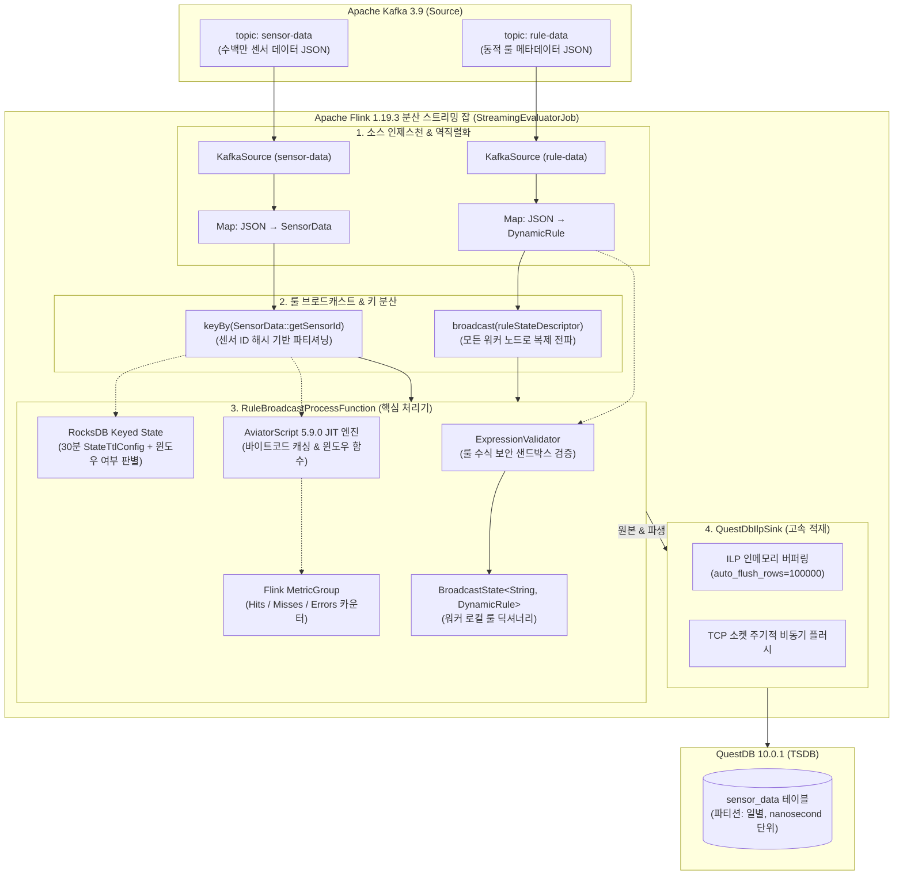
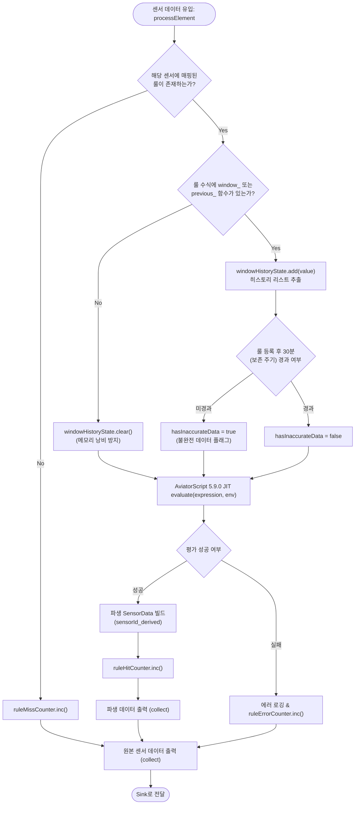
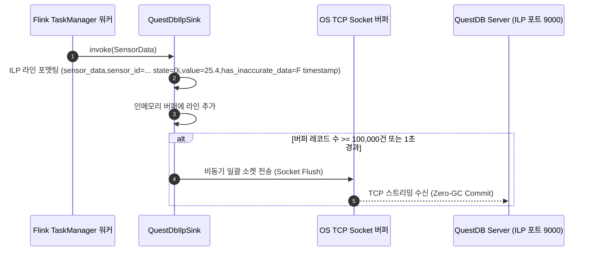

# 🌊 Flink 스트리밍 평가 및 룰 전파 아키텍처 가이드 (Streaming Evaluator Guide)

본 문서는 **Formula Evaluator Service**의 분산 실시간 스트리밍 처리 모듈인 **`formula-flink`**의 내부 아키텍처, Flink 1.19.3 파이프라인 구성, 동적 룰 브로드캐스트 패턴, RocksDB 상태 관리 및 QuestDB ILP 고속 적재 원리를 다루는 엔지니어링 기술 가이드입니다.

---

## 1. 개요 및 설계 목표

산업 현장의 IoT 센서 환경에서는 수백만 대의 디바이스로부터 1초 이하 간격으로 원본 텔레메트리 데이터가 유입됩니다. 동시에 운영자는 런타임에 언제든지 새로운 수식(Rule)을 등록하거나 수정할 수 있어야 합니다.

`formula-flink`는 이러한 요구사항을 충족하기 위해 다음과 같은 핵심 설계 목표를 가집니다:
* **무중단 동적 룰 갱신 (Zero-Downtime Rule Updates)**: 스트리밍 잡을 재시작하지 않고도 Kafka를 통해 새 룰을 전파받아 즉시 반영.
* **외부 조회 배제 (Zero External Lookup)**: 센서 1건 처리 시 Redis나 RDBMS를 왕복 조회하지 않고 워커 로컬 메모리에서 즉각 수식을 매핑 및 계산.
* **무제한 힙 팽창 방지 (Bounded State Management)**: Flink RocksDB StateBackend 및 30분 State TTL을 통해 대규모 슬라이딩 윈도우 환경에서도 OOM 방지.
* **초고속 비동기 싱크 (High-Throughput Sink)**: Influx Line Protocol(ILP) TCP 소켓 통신을 통해 10만 건 단위 비동기 플러시 수행.

---

## 2. 스트리밍 파이프라인 아키텍처 (End-to-End Pipeline)



---

## 3. 핵심 컴포넌트 및 동작 원리

### 3.1 `StreamingEvaluatorJob` (파이프라인 진입점)
* **Configuration 기반 State Backend 설정 (Flink 1.19+ 최신 표준)**:
  ```java
  Configuration config = new Configuration();
  config.set(StateBackendOptions.STATE_BACKEND, "rocksdb");
  config.set(CheckpointingOptions.INCREMENTAL_CHECKPOINTS, true);
  StreamExecutionEnvironment env = StreamExecutionEnvironment.getExecutionEnvironment(config);
  ```
  과거 버전의 `env.setStateBackend(...)` 대신 Flink 1.19 공식 권장 사양인 `Configuration`과 `StateBackendOptions`를 적용하여 증분 체크포인트(Incremental Checkpoints)를 기본 활성화합니다.
* **센서 및 룰 소스 결합**:
  - `sensorStream.keyBy(SensorData::getSensorId)`: 수백만 개의 센서를 TaskManager 워커 노드들에 락(Lock) 없이 고르게 분산.
  - `ruleStream.broadcast(ruleStateDescriptor)`: 룰 변경 이벤트를 모든 분산 TaskManager 워커의 로컬 메모리로 100% 복제 전파.
  - `.connect(broadcastRuleStream).process(...)`: KeyedStream과 BroadcastStream을 연결하여 동적 평가 수행.

---

### 3.2 `RuleBroadcastProcessFunction` (동적 룰 평가 프로세서)



#### ① 엄격한 수식 사전 검증 (`processBroadcastElement`)
운영자가 브로드캐스트 토픽(`rule-data`)으로 룰을 발행하면 각 TaskManager 워커는 이를 상태에 저장하기 전에 [`ExpressionValidator.validate(expr)`](file:///C:/Users/imoil/repo/formula-evaluator-service/formula-engine/src/main/java/com/imoil/formula/engine/ExpressionValidator.java)를 호출합니다.
- 악성 시스템 호출(`System.exit`, `Runtime.getRuntime().exec` 등)이나 임의 클래스 생성이 포함된 경우 상태에 등록하지 않고 에러를 로깅하여 워커 다운을 방지합니다.
- 수식에 `window_` 또는 `previous_` 함수가 사용되었는지를 사전 판별하여 `rule.setUsesWindow(true/false)`를 캐싱합니다.

#### ② 윈도우 미사용 룰의 상태 메모리 절약
* 모든 센서에 대해 30분 동안의 시계열 데이터를 맹목적으로 적재하면 대규모 OOM이 발생합니다.
* `rule.isUsesWindow() == false`인 단순 사칙연산(`value * 1.8 + 32` 등)인 경우 `windowHistoryState.clear()`와 `ruleStartTimeState.clear()`를 호출하여 RocksDB 디스크 및 힙 자원을 0으로 유지합니다.

#### ③ 불완전 윈도우 데이터 플래깅 (`hasInaccurateData`)
* 이동 평균(`window_avg(10)`) 등 과거 데이터가 필요한 룰이 런타임에 새로 등록되면, 초기에는 윈도우 버퍼에 10개 분량의 데이터가 채워지지 않아 부정확한 계산값이 도출될 수 있습니다.
* `RuleBroadcastProcessFunction`은 룰이 최초 적용된 시점(`ruleStartTimeState`)을 추적하여 지정된 보존 주기(`retentionTimeMinutes`)가 지나기 전까지는 생성되는 파생 데이터에 `hasInaccurateData = true` 플래그를 부착합니다.

#### ④ 분산 워커 내 자체 JIT 엔진 캐싱
* Flink TaskManager는 Spring ApplicationContext 없이 독립적인 JVM 프로세스로 기동됩니다.
* 따라서 `open(Configuration parameters)` 생명주기 메서드에서 [`RuleEngineConfig`](file:///C:/Users/imoil/repo/formula-evaluator-service/formula-engine/src/main/java/com/imoil/formula/engine/RuleEngineConfig.java)를 통해 `AviatorEvaluatorInstance`를 로컬에 직접 초기화하고 커스텀 함수(`WindowAvgFunction`, `WindowMaxFunction`)를 바인딩하여 JVM 레벨 바이트코드 캐시를 보장합니다.

---

### 3.3 `QuestDbIlpSink` (Influx Line Protocol 고속 싱크)

QuestDB는 표준 RDBMS 대비 100배 이상의 쓰기 성능을 제공하는 TSDB입니다. `QuestDbIlpSink`는 행 단위 JDBC INSERT를 배제하고 TCP 소켓 기반 ILP 프로토콜로 비동기 배치 적재를 수행합니다.



---

## 4. 운영 및 모니터링 가이드 (Observability & Metrics)

`RuleBroadcastProcessFunction`은 Flink 내장 `MetricGroup`을 통해 실시간 운영 현황을 프로메테우스(Prometheus) 및 Flink 대시보드에 노출합니다.

| 메트릭 명칭 | 메트릭 유형 | 설명 | 장애 대응 가이드 |
| :--- | :--- | :--- | :--- |
| `ruleEvaluationHits` | Counter | 센서에 룰이 정상 매핑되어 파생 데이터 계산에 성공한 횟수 | 트래픽 대비 증가율 정상 여부 모니터링 |
| `ruleEvaluationMisses` | Counter | 룰이 등록되지 않아 원본 데이터만 통과한 횟수 | 미등록 센서 유입량 추적 |
| `ruleEvaluationErrors` | Counter | 수식 실행 중 0으로 나누기, 파싱 실패 등으로 오류가 발생한 횟수 | 급증 시 룰 토픽의 수식 문법 및 잘못된 필드 점검 |

---

## 5. 실행 및 파라미터 규격

### 5.1 Flink CLI 잡 제출 명령
```bash
flink run -c com.imoil.formula.flink.StreamingEvaluatorJob \
  formula-flink/build/libs/formula-flink-0.0.1-SNAPSHOT.jar \
  --kafka-bootstrap-servers "localhost:9092" \
  --kafka-topic-sensor "sensor-data" \
  --kafka-topic-rule "rule-data" \
  --retention-time-minutes 30 \
  --questdb-url "http::addr=localhost:9000;auto_flush_interval=1000;auto_flush_rows=100000;"
```

### 5.2 파라미터 상세
| 파라미터 키 | 필수 | 기본값 | 설명 |
| :--- | :---: | :--- | :--- |
| `--kafka-bootstrap-servers` | 선택 | `localhost:9092` | Kafka 클러스터 접속 주소 |
| `--kafka-topic-sensor` | 선택 | `sensor-data` | 원본 IoT 센서 데이터 수신 토픽 |
| `--kafka-topic-rule` | 선택 | `rule-data` | 관리자 동적 룰 정의 브로드캐스트 토픽 |
| `--kafka-group-sensor` | 선택 | `formula-sensor-evaluator-group` | 센서 데이터 컨슈머 그룹 ID |
| `--kafka-group-rule` | 선택 | `formula-rule-broadcast-group` | 룰 데이터 컨슈머 그룹 ID |
| `--retention-time-minutes` | 선택 | `30` | RocksDB State TTL 보존 시간 (분 단위) |
| `--questdb-url` | 선택 | `http::addr=localhost:9000;...` | QuestDB ILP 싱크 접속 및 버퍼링 설정 문자열 |
