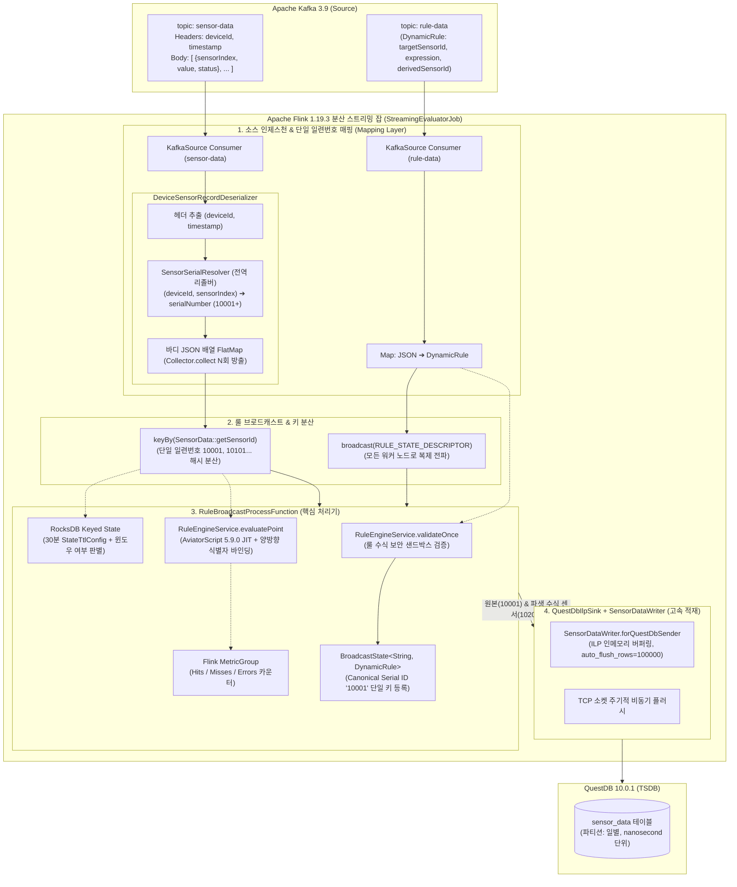
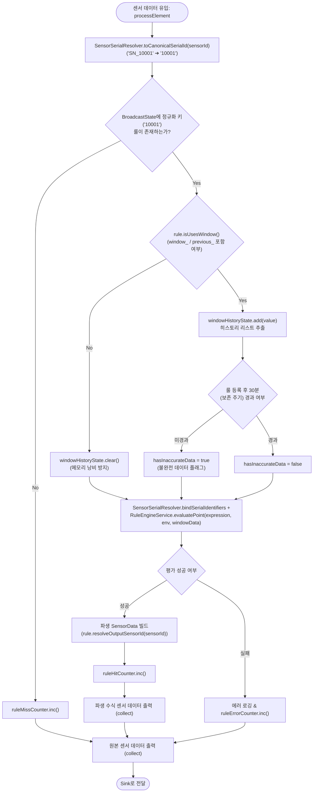

# 🌊 Flink 스트리밍 평가 및 룰 전파 아키텍처 가이드 (Streaming Evaluator Guide)

본 문서는 **Formula Evaluator Service**의 분산 실시간 스트리밍 처리 모듈인 **`formula-flink`**의 내부 아키텍처, Flink 1.19.3 파이프라인 구성, 카프카 컨슈머-데이터소스 간 단일 일련번호 매핑 계층, 동적 룰 브로드캐스트 패턴, RocksDB 상태 관리 및 QuestDB ILP 고속 적재 원리를 다루는 엔지니어링 기술 가이드입니다.

---

## 1. 개요 및 설계 목표

산업 현장의 IoT 센서 환경에서는 수백만 대의 디바이스로부터 1초 이하 간격으로 원본 텔레메트리 데이터가 유입됩니다. 동시에 운영자는 런타임에 언제든지 새로운 수식(Rule)을 등록하거나 수정할 수 있어야 합니다.

`formula-flink`는 이러한 요구사항을 충족하기 위해 다음과 같은 핵심 설계 목표를 가집니다:
* **다중 설비 간 센서 식별자 충돌 방지 (Multi-Device Disambiguation)**: `DEVICE-001`과 `DEVICE-002`가 동일하게 0번 센서(`sensorIndex: 0`)를 전송해도 카프카 역직렬화 단계에서 전역 고유 일련번호(`10001`, `10101` 등)로 매핑하여 Flink 상태(State) 오염 원천 차단.
* **무중단 동적 룰 갱신 (Zero-Downtime Rule Updates)**: 스트리밍 잡을 재시작하지 않고도 Kafka를 통해 새 룰을 전파받아 즉시 반영.
* **외부 조회 배제 (Zero External Lookup)**: 센서 1건 처리 시 Redis나 RDBMS를 왕복 조회하지 않고 워커 로컬 메모리에서 즉각 수식을 매핑 및 계산.
* **무제한 힙 팽창 방지 (Bounded State Management)**: Flink RocksDB StateBackend 및 30분 State TTL을 통해 대규모 슬라이딩 윈도우 환경에서도 OOM 방지.
* **초고속 비동기 싱크 (High-Throughput Sink)**: Influx Line Protocol(ILP) TCP 소켓 통신을 통해 10만 건 단위 비동기 플러시 수행.

---

## 2. 스트리밍 파이프라인 아키텍처 (End-to-End Pipeline)



---

## 3. 핵심 컴포넌트 및 동작 원리

### 3.1 `DeviceSensorRecordDeserializer` 및 `SensorSerialResolver` (매핑 계층)
* **문제 배경**: 서로 다른 IoT 장치(`DEVICE-001`, `DEVICE-002`)가 각각 `sensorIndex: 0`을 전송하면 Flink의 `keyBy(SensorData::getSensorId)`에서 두 장치의 데이터가 동일한 키로 묶여 심각한 상태 충돌이 일어납니다.
* **해결 원리**:
  1. `KafkaSource`가 소비한 레코드에서 `deviceId`와 `timestamp` 헤더를 추출합니다.
  2. 바디 JSON 배열을 순회하며 [`SensorSerialResolver`](file:///var/home/imoil/repo/formula-evaluator-service/formula-core/src/main/java/com/imoil/formula/domain/SensorSerialResolver.java)를 호출합니다:
     ```java
     long serialNumber = resolver.resolveSerialNumber(deviceId, item.getSensorIndex());
     String sensorId = String.valueOf(serialNumber); // 예: "10001", "10101"
     ```
  3. 사전에 Oracle DB에서 동기화된 일련번호가 존재할 경우 해당 번호(`10001+`)를 부여하고, 미등록 센서라도 장치 번호 기반 결정론적 오프셋을 통해 장치 간 중복이 원천 차단됩니다.
  4. Flink의 `DataStreamSource`로 방출되는 모든 `SensorData`는 이미 단일 일련번호가 부여되어 있으므로, 다운스트림의 `keyBy` 파티셔닝과 룰 매칭이 완벽히 격리됩니다.

### 3.2 `RuleBroadcastProcessFunction` (동적 룰 평가 프로세서)



#### ① 정규화 일련번호(Canonical Serial ID) 단일 키 룰 매칭 (`processBroadcastElement` & `processElement`)
사용자나 UI는 룰을 등록할 때 대상 센서를 `"10001"` 또는 `"SN_10001"`로 지정할 수 있습니다.
- `processBroadcastElement`에서 `ruleEngineService.validateOnce(rule.getExpression())`로 수식을 사전 검증한 뒤, `rule.canonicalTargetSerialId()`를 통해 정규화된 단일 키(`"10001"`) 하나로 `RULE_STATE_DESCRIPTOR`(`BroadcastState`)에 저장합니다 (중복 키 이중 적재 제거).
- `processElement`에서 유입된 센서 ID가 `"10001"`이든 `"SN_10001"`이든 `SensorSerialResolver.toCanonicalSerialId(value.getSensorId())`로 정규화하여 즉각 $O(1)$로 매핑 룰을 조회합니다.

#### ② 파생 수식 센서 일련번호 방출 (`DynamicRule.resolveOutputSensorId`)
`rule.resolveOutputSensorId(value.getSensorId())`를 통해 룰 정의에 `derivedSensorId`가 지정되어 있을 경우(예: `"10201"`) 해당 일련번호로 방출하고, 미지정 시 기존 호환성을 위해 `sensorId + "_derived"`로 방출합니다.

#### ③ 단일 일련번호 변수 자동 바인딩 및 `RuleEngineService.evaluatePoint` 위임
- `SensorSerialResolver.bindSerialIdentifiers(env, value.getSensorId(), value.getValue())`를 호출하여 `env.put("value", ...)` 외에도 `"10001"`과 `"SN_10001"`을 양방향 바인딩하므로, 수식 내에서 `SN_10001 * 1.8 + 32.0` 또는 `10001 * 1.8 + 32.0` 형태로 직접 참조할 수 있습니다.
- `RuleEngineService.evaluatePoint(rule.getExpression(), env, windowData)`가 `AbstractWindowFunction.bindWindowHistory`를 내부에서 캡슐화하여 슬라이딩 윈도우 데이터 바인딩 및 JIT 평가를 일원화합니다.

#### ④ 백엔드 실시간 룰 발행 및 인메모리 일괄 동기화 (Bulk Sync)
- Flink 컨슈머는 `OffsetsInitializer.latest()`를 유지하여 과거 수십 차례 수정된 구버전 수식의 Replay Churn을 차단합니다.
- `formula-api`의 `RulePublisherService`가 Oracle DB 최신 수식 센서를 실시간(`createSensor`, `updateSensor`) 또는 일괄(`POST /api/v1/registry/sensors/rules/sync`, UI "Sync Rules to Flink" 버튼)로 카프카 `rule-data` 토픽에 발행합니다.
- TaskManager의 `RuleBroadcastProcessFunction`은 브로드캐스트 스트림을 통해 실시간으로 `BroadcastState`를 최신화하여 무중단 수식 평가를 보장합니다.

---

## 4. 운영 및 검증 가이드

### 단위/통합 테스트 스위트
* [`DeviceSensorRecordDeserializerTest.java`](file:///var/home/imoil/repo/formula-evaluator-service/formula-flink/src/test/java/com/imoil/formula/flink/DeviceSensorRecordDeserializerTest.java):
  - 카프카 헤더/바디 역직렬화 및 단일 일련번호 매핑 검증.
  - `DEVICE-001`과 `DEVICE-002`가 동일한 `sensorIndex: 0`을 전송할 때 각각 `10001`, `10101`로 충돌 없이 분리 매핑됨을 검증.
* [`RuleBroadcastProcessFunctionTest.java`](file:///var/home/imoil/repo/formula-evaluator-service/formula-flink/src/test/java/com/imoil/formula/flink/RuleBroadcastProcessFunctionTest.java):
  - 단일 일련번호 `SN_10001`에 대한 룰 브로드캐스트와 실시간 스트림 센서(`10001`)의 매칭 평가 검증.
  - 파생 센서 `derivedSensorId: 10201`이 정상 계산되어 방출됨을 검증.
  - `testBulkDynamicRuleBroadcastAndEvaluation`: 복수 개의 동적 룰 브로드캐스트 유입 시 각 센서별로 독립 수식 평가 및 파생 센서 방출 검증 통과.

---

## 📚 관련 문서
* [시스템 전체 아키텍처 및 상세 엔지니어링 가이드 (ARCHITECTURE_GUIDE.md)](../ARCHITECTURE_GUIDE.md)
* [도메인 용어 사전 (GLOSSARY.md)](../GLOSSARY.md)
* [IoT 센서 에뮬레이션 및 엔드투엔드 파이프라인 가이드 (SENSOR_SIMULATION_AND_PIPELINE_GUIDE.md)](SENSOR_SIMULATION_AND_PIPELINE_GUIDE.md)
* [Formula UI 아키텍처 및 사용자 가이드 (FRONTEND_UI_GUIDE.md)](FRONTEND_UI_GUIDE.md)
